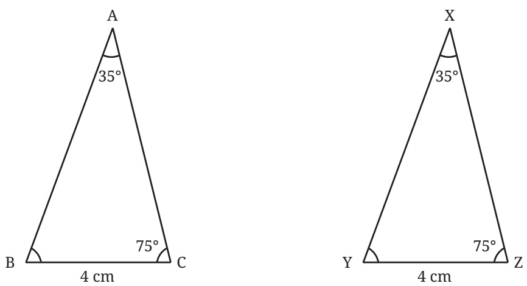
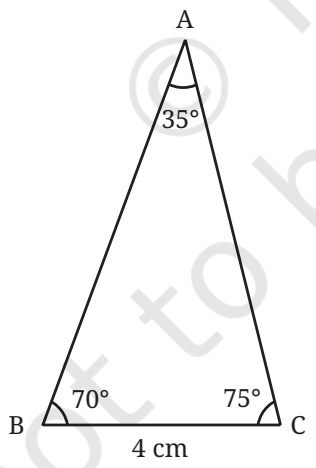
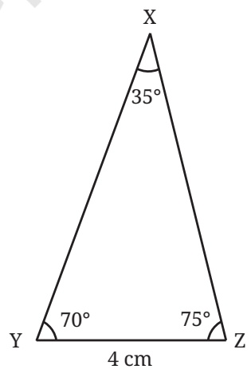

Fig.1.2

How do we proceed with this problem? Here is a method.

What are the measures of $\angle \mathrm { B }$ and $\angle \mathrm { Y ? }$

We know that the sum of the angles of a triangle is $1 8 0 ^ { \circ } { \textless }$ So $\angle B + 35^{\circ} + 75^{\circ} = 180^{\circ},$ or $\angle \mathrm{B} + 110^{\circ} = 180^{\circ}$ Thus, $\angle \mathrm{B} = 70^{\circ}.$ Similarl $y , \angle Y$ is also $7 0 ^ { \circ } .$ Thus, we have $\angle \mathrm{B} = \angle \mathrm{Y}.$

? Does this help in showing that ΔABC and ΔXYZ are congruent?

These two triangles now satisfy the ASA condition with

$$
\begin{array} { r } { \angle \mathrm { B } = \angle \mathrm { Y } } \\ { \mathrm { B C } = \mathrm { Y Z } } \\ { \angle \mathrm { C } = \angle \mathrm { Z } . } \end{array}
$$

So, $\Delta \mathrm { A B C } \cong \Delta \mathrm { X Y Z } .$