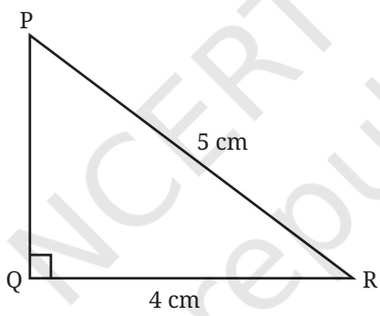
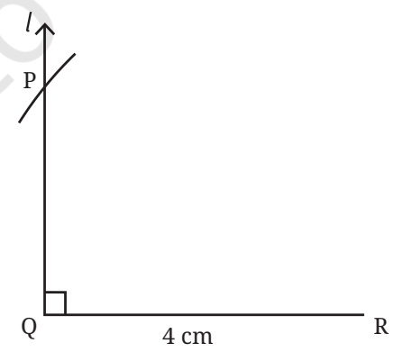

In Fig. 1.2, the equalities are between two angles and the non-included side of the two triangles. This condition is referred to as the **AAS (Angle Angle Side)** condition.

As we have seen, the AAS condition guarantees congruence.

We have seen that the SSA condition doesn’t always guarantee congruence. However, there are some special cases when SSA does guarantee congruence. Here is one such important case.

## Measuring Two Sides in a Right Triangle

？ ΔABC and ΔXYZ are right-angled triangles such that $BC = YZ = 4$ cm, $\angle \mathrm{B} = \angle \mathrm{Y} = 90^{\circ}$ and AC = XZ=5cm. Are they congruent?

？ Can there exist non-congruent triangles having these measurements? Construct and find out.

Looking at the rough diagram helps in planning the construction.

**Step 1:** Draw the base QR of length 4 cm.

**Step 2:** Draw a line l perpendicular to QR from Q.

**Step 3:** From R, cut an arc on line l of radius 5 cm.

**Step 4:** Let P be the point at which the arc intersects the line l. Join PR.

ΔPQR is the required triangle.