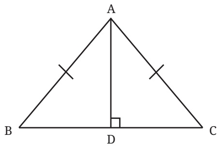
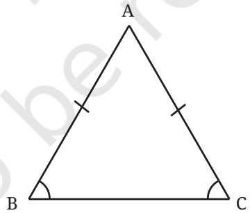
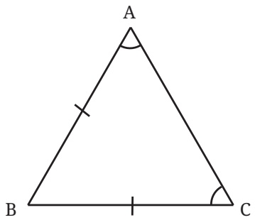

We have,

$$
\mathrm{AB} = \mathrm{AC}   ( given )
$$

∠ADB = ∠ADC = 90° (from construction)

AD is a common side of the two triangles $\Delta \mathrm { A D B }$ and $\Delta \mathrm { A D C }$

Thus, the triangles satisfy the RHS condition. Hence, $\Delta  ADB \cong \Delta  ADC$ This shows that $\angle \mathrm{B} = \angle \mathrm{C},$ as they are corresponding parts of congruent triangles.

Thus, the angles opposite to equal sides are equal.

Can you use this fact to find $\angle \mathrm { B }$ and $\angle C ?$

**Angles in an Equilateral Triangle**

Equilateral triangles are those in which all the sides have equal lengths.

What can we say about their angles?

We can use the recently discovered fact that angles opposite to equal sides are equal.

The sides AB and AC are equal. $\mathrm{SO} \angle \mathrm{B} = \angle \mathrm{C}.$

