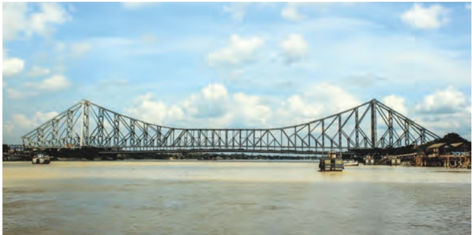
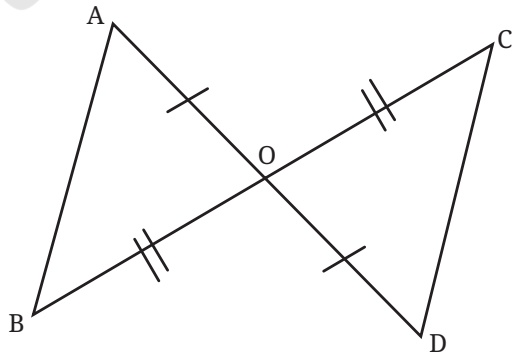

Rabindra Setu or Howrah Bridge

Describe the congruent triangles you see in each picture.

## Figure it Out

1. ΔAIR ≅ ΔFLY. Identify the corresponding vertices, sides and angles.

2. Each of the following cases contains certain measurements taken from two triangles. Identify the pairs in which the triangles are congruent to each other, with reason. Express the congruence whenever they are congruent.

(a)

$$
{ \begin{array} { l } { \operatorname { A B } = \operatorname { D E } } \\ { \operatorname { B C } = \operatorname { E F } } \\ { \operatorname { C A } = \operatorname { D F } } \end{array} }\tag{b}
$$

$$
\begin{array}{l}\mathrm{AB} = \mathrm{EF} \\\angle \mathrm{A} = \angle \mathrm{E} \\\mathrm{AC} = \mathrm{ED}\end{array}
$$

$$
\begin{array} { r l } { ( \mathrm { c } ) } & { \mathrm { A B } = \mathrm { D F } } \\ & { \angle \mathrm { B } = \angle \mathrm { D } = 9 0 ^ { \circ } } \\ & { \mathrm { A C } = \mathrm { F E } \sim \mathrm { C } } \end{array}\tag{d}
$$

$$
\begin{array}{l}\angle \mathrm{A} = \angle \mathrm{D} \\\angle \mathrm{B} = \angle \mathrm{E} \\\overline{\mathrm{AC}} = \mathrm{DF}\end{array}
$$

$$
\begin{array} { r l } { ( \mathbf { e } ) \quad } & { \mathrm { A B } = \mathrm { D F } } \\ & { \angle \mathrm { B } = \angle \mathrm { F } } \\ & { \mathrm { A C } = \mathrm { D E } } \end{array}
$$

3. It is given that OB = OC, and OA = OD. Show that AB is parallel to CD. [**Hint:** AD is a transversal for these two lines. Are there any equal alternate angles?]

