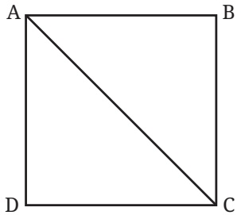
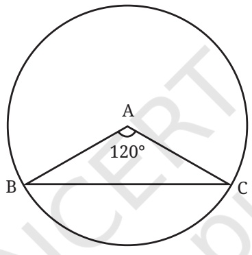
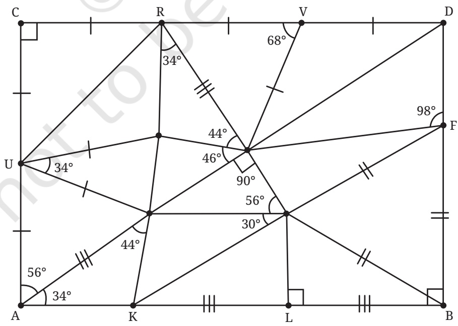

4. ABCD is a square. Show that $\Delta  ABC  \cong \Delta  ADC.$ . Is $\Delta \mathrm { A B C }$ also congruent to ΔCDA?

Give more examples of two triangles where one triangle is congruent to the other in two different ways, as in the case above. Can you give an example of two triangles where one is congruent to the other in six different ways?

5. Find $\angle \mathrm { B }$ and $\angle \mathbb { C } ,$ if A is the centre of the circle.

6. Find the missing angles. As per the convention that we have been following, all line segments marked with a single $^ \circ \big \vert ^ { \circ }$ are equal to each other and those marked with a double $^ \circ \big \vert ^ { \circ }$ are equal to each other, etc.

