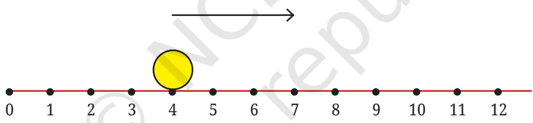
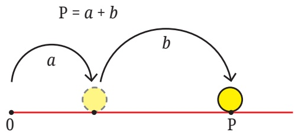

puzzle, you get the answer to Rakesh’s second puzzle. That is, the first number is 7 and the second is 18!

## Figure it Out

Let us try to find a few more pairs of numbers from their sums and differences:

$$
(a) \  Sum  = 27,  Difference  = 9
$$

$$
\mathrm{(b)~~Sum=4,~Difference=12}
$$

$$
\mathrm{(c)} \quad \mathrm{Sum} = 0, \quad \mathrm{Difference} = 10
$$

$$
\mathrm{~(d)~~~Sum~=~0,~Difference~=~-10}
$$

(e)	 Sum = – 7, Difference = – 1

$$
\mathrm{~(f)~~~Sum~=~-7,Difference~=~-13}
$$

Choose a partner and take turns to play this game. In each turn, one of you can think of two integers, and give their sum and difference; the other person must then figure out the integers. After some practice, you can perform this magic trick for your family members and surprise them!

## Carrom Coin Integers

A carrom coin is struck to move it to the right. Each strike moves the coin a certain number of units of distance rightwards based on the force of the strike.

？ To begin with, the coin is at point 0. If the coin is struck twice, with the first strike moving it by 4 units and the second strike moving it by 3 units, what will be the final position of the coin?

It is clear that the coin will be 4 + 3 = 7 units from 0.

? If the coin is struck twice, and if the two movements are known, can you give a formula for the final position of the coin?

If the first strike moves the coin $^ { \circ } a ^ { \prime }$ units to the right and if the second strike moves the coin ‘b’ units to the right, then the final position is $\mathbf { P } = a + b ,$ , where P is the distance of the coin from the starting point 0.

