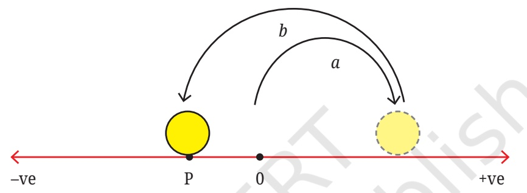
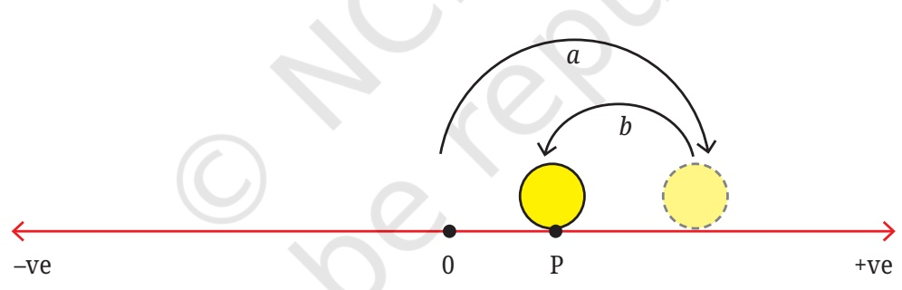
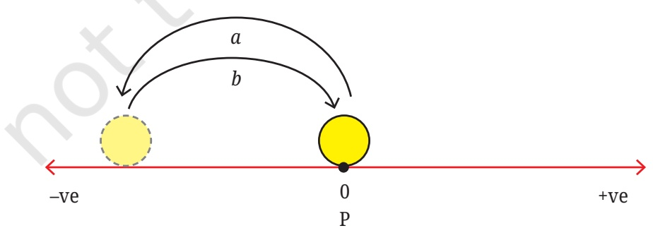

2. If there are multiple strikes causing movements in the order 1, – 2, 3, $- 4 , . . . , - 1 0 ,$ , what is the final position of the coin?

By modeling the movements as numbers, both positive and negative, we are able to capture two pieces of information — the distance (magnitude) and the direction (rightwards or leftwards). For example, when we say the movement is – 4, the **magnitude** is 4 and the direction is leftward.

? From the figures below, what can you conclude about the magnitudes of a and b compared to each other, and what are their directions? Remember to start from 0.

1.

2.

3.

