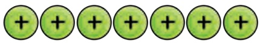
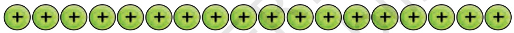
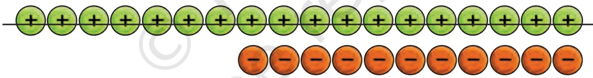
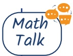

In addition to the number line, we used the token model to understand integers. We used this model to perform addition and subtraction in Grade 6. Let us do a quick recall. We used green ( ) token to represent positive 1 and red ( ) token to represent negative 1, that is –1. Together they make zero, as they cancel each other out.

## Find (+7) – (+18).

To subtract 18 from 7, i.e., (+7) – (+18), we need to remove 18 positives from 7 positives.

But there are not enough tokens to remove 18 positives! We put in enough zero pairs so that we can remove 18 positives.

## How many?

We have 7 positives and we need 11 more. So we need to put in 11 zero pairs:

We can now remove 18 positives.

What is left? There are 11 negatives, meaning –11.

So, 7 – 18 = –11.

We had also seen that subtracting a number is the same as adding its additive inverse.

Using tokens, argue out the following statements.

(a) 7 – 18 = 7 + (– 18) (additive inverse of 18 is – 18)

(b) 4 – (– 12) = 4 + 12 (additive inverse of – 12 is 12)

**Note to the Teacher:** Tokens of different shapes may be used for positive and negative numbers for visually challanged students.