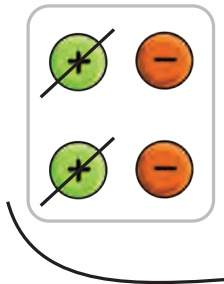
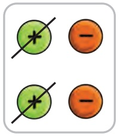
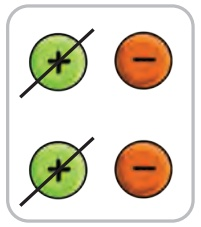
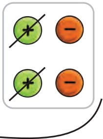
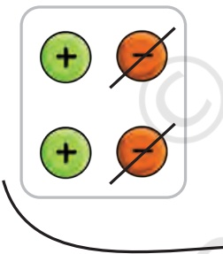
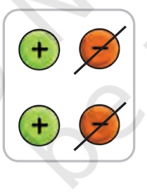
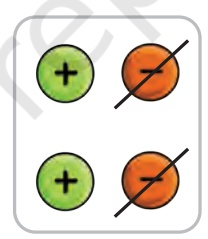
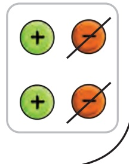

Why are we trying to remove green tokens and not red tokens?

But there are no tokens in the bag, because we start with an empty bag. Just as in the case of subtraction, to remove 2 positives from an empty bag, we need to first place 2 zero pairs inside and then remove the 2 positives. We need to do this 4 times.

Remove 2 green tokens from the zero pairs, 4 times

(–  4) × 2 = –  8

After removing the positives, 8 negatives are left in the bag. This is – 8. This shows that (– 4) × 2 = – 8.

？ What happens when both the integers in the multiplication are negative? How do we model (–4) × (–2) with tokens?

For (– 4) × (– 2), we need to remove 2 negatives from the bag 4 times. Since there are no red tokens in the bag, we need to place 2 zero pairs and remove 2 negatives, and we need to do this 4 times.

Remove 2 red tokens from the zero pairs, 4 times

$$
(-4) \times (-2) = 8
$$

8 positives are left in the bag. This is + 8.

So,

$$
-4 \times -2 = +8.
$$

So far, we have established the following results by using tokens:

$$
4 \times 2 = 8 ,
$$

$$
4 \times ( - 2 ) = - 8
$$

$$
(-4) \times 2 = -8,  and
$$

$$
(-4) \times (-2) = 8.
$$