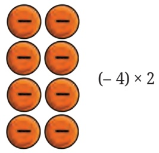

Since removing 2 positive tokens is the same as adding 2 negative tokens, $- 4 \times 2$ can also be obtained by adding 2 negative tokens to the empty bag 4 times.

## Patterns in Integer Multiplication

We have explored the multiplication of integers in cases where the multiplier is positive, when it is negative, when the multiplicand is positive and when it is negative. Using this understanding, let us construct a sequence of multiplications and observe the patterns.

What do you notice in this pattern? Can you describe it?

We can see that, when the multiplicand is positive, for every unit **decrease** in the multiplier the product **decreases** by the multiplicand.

$$
\begin{array}{l}4 \times 3 = 12 \\3 \times 3 = 9 \\2 \times 3 = 6 \\1 \times 3 = 3 \\0 \times 3 = 0 \\\end{array}\begin{array}{l}\sum - 3 \\\sum - 3 \\\sum - 3 \\\end{array}
$$

Will this pattern continue when the multiplier goes below zero and becomes a negative number?

Yes indeed! The same pattern continues when the multiplier becomes a negative number.

What is the pattern when the multiplicand is a negative integer?

$$
\begin{array}{l}4 \times (-3) = -12 \\3 \times (-3) = -9 \\2 \times (-3) = -6 \\1 \times (-3) = -3 \\0 \times (-3) = 0\end{array}\quad\begin{array}{l}\infty + 3 \\\infty + 3 \\\infty + 3 \\\infty + 3 \\\infty + 3 \\\infty + 3 \\\infty + 3 \\\infty + 3 \\\infty + 3 \\\infty + 3 \\\infty + 3 \\\infty + 3 \\\infty + 3 \\\infty + 3 \\\infty + 3 \\\infty + 3 \\\infty + 3 \\\infty + 3 \\\infty + 3 \\\infty + 3 \\\infty + 3 \\\infty + 3 \\\infty + 3 \\\infty + 3 \\\infty + 3 \\\infty + 3 \\\infty + 3 \\\infty + 3 \\\infty + 3 \\\infty + 3 \\\infty + 3 \\\infty + 3 \\\infty + 3 \\\infty + 3 \\\infty + 3 \\\infty + 3 \\\infty + 3 \\\infty + 3 \\\infty + 3 \\\infty + 3 \\\infty + 3 \\\infty + 3 \\\infty + 3 \\\infty + 3 \\\infty + 3 \\\infty + 3 \\\infty + 3 \\\infty + 3 \\\infty + 3 \\\infty + 3 \\\infty + 3 \\\infty + 3 \\\infty + 3 \\\infty + 3 \\\infty + 3 \\\infty + 3 \\\infty + 3 \\\infty + 3 \\\infty + 3 \\\infty + 3 \\\infty + 3 \\\infty + 3 \\\infty + 3 \\\infty + 3 \\\infty + \infty + 3 \\\infty + 3 \\\infty + \infty + 3 \\\infty + 3 \\\infty + \infty + 3 \\\infty + \infty + 3 \\\infty + \infty + 3 \infty + \infty + 3 \\\infty + \infty + \infty + 3 \infty + \infty + \infty \infty + \infty \infty + \infty + \infty \infty + \infty \infty + \infty \infty \infty + \infty \infty \quad \infty \infty \quad \infty \quad \infty \infty \quad \infty \infty \quad \infty \infty \quad \infty \infty \quad \infty \infty \quad \infty \infty \infty \quad \infty \infty \quad \infty \infty \quad \infty \infty \infty \quad \infty \infty \quad \infty \infty \infty \quad \infty \infty \quad \infty \infty \quad \infty \infty \infty \quad \infty \infty \quad \infty \infty \infty \quad \infty \infty \quad \infty \infty \infty \quad \infty \infty \quad \infty \infty \infty \quad \infty \infty \quad \infty \infty \infty \quad \infty \infty \infty \quad \infty \infty \quad \infty \infty \infty \quad \infty \infty \infty \quad \infty \infty \quad \infty \infty \quad \infty \infty \infty \infty \quad \infty \infty \quad \infty \infty \infty \quad \infty \infty \quad \infty \infty \infty \quad \infty \infty \infty \quad \infty \infty \quad \infty \infty \quad \infty \infty \quad \infty \infty \infty \quad \infty \infty \quad \infty \infty \quad \infty \infty \infty \quad \infty \infty \infty \quad \infty \quad \infty \quad \infty \infty \infty \quad \infty \quad \infty \infty \quad \infty \infty \quad \infty \quad \infty \quad \infty \infty \quad \infty \quad \quad \infty \quad \quad \infty \� \quad \infty \� \quad \quad \� \� \� \� \quad \� \� \quad \� \� \quad \� \� \� \� \quad \� \� \� \� \� \� \� \� \� \� \� \� \� \� \quad \� \� \� \� \� \� \� \� \� \� \� \� \� \� \� \� \� \� \� \� \� \� \� \� \� \� \� \� \� \� \� \ \end{array}
$$

$$
\begin{array} { r } { 4 \times 3 = 1 2 \quad \bigotimes - 3 } \\ { 3 \times 3 = 9 \quad \bigotimes - 3 } \\ { 2 \times 3 = 6 \quad \bigotimes - 3 } \\ { 1 \times 3 = 3 \quad \bigotimes - 3 } \\ { 0 \times 3 = 0 \quad \bigotimes - 3 } \\ { - 1 \times 3 = - 3 \quad \bigotimes - 3 } \\ { - 2 \times 3 = - 6 \quad \bigotimes - 3 } \\ { - 3 \times 3 = - 9 \quad \bigotimes - 3 } \end{array}
$$

This is the inverse of the previous pattern. When the multiplicand is negative, for every unit **decrease** of the multiplier, the product **increases** by the multiplicand.

？ Will this pattern continue when the multiplier goes below zero and becomes a negative integer?

Yes!