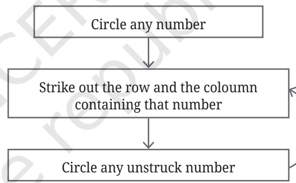

The position of the elevator after 60 minutes is 180 metres below the ground level.

Find the solution to part (b) using Method 1 described above.

Solution to part (b) using Method 2:

Starting Position = 15.

Distance Travelled = The elevator moves down at the speed of 3 metres per minute for 45 minutes, that is, (45 × (–3)). So,

Ending Position = 15 + (45 × (–3)) = 15 + (–(45×3)) = 15 + (–135) = (–120).

The elevator will be 120 metres below the ground.

## A Magic Grid of Integers

？ A grid containing some numbers is given below. Follow the steps as shown until no number is left.

| 8 | -4 | 12 | -6 |
| --- | --- | --- | --- |
| -28 | 14 | -42 | 21 |
| 12 | -6 | 18 | -9 |
| 20 | -10 | 30 | -15 |

When there are no more unstruck numbers, stop. Multiply the circled numbers.

An example is shown below.

Round 1

|  |  |  |  |  |  |  |
| --- | --- | --- | --- | --- | --- | --- |
|  | 5 |  | 4 | 12 | C | 6 |
|  |  | G |  |  |  |  |
|  |  |  | 4 | -42 | 乙 |  |
|  | 12 | - | 6 | 18 |  | 9 |
| 6 |  |  |  |  |  |  |
| Z |  | -1 | 0 | 30 |  | 5 |

Round 2

|  |  |  |  |  |  |
| --- | --- | --- | --- | --- | --- |
| 8 | 1 |  | 412 |  | 6 |
|  |  |  |  |  |  |
|  |  |  | -2814-42 | 2 |  |
|  |  |  | 12 -6 18 |  | 9 |
|  |  |  |  |  |  |
| 20-10 30 |  |  |  |  | 1.5 |

Round 3

|  |  |  |  |  |  |  |
| --- | --- | --- | --- | --- | --- | --- |
|  |  |  | 4 | 12 |  | 6 |
|  |  | G |  |  |  |  |
|  | 8 |  | 4 | -42 |  |  |
|  | 2 |  | 6 | 18 |  | 9 |
| 6 |  |  |  |  |  |  |
| 2 |  |  | 0 | 30 |  | 1.5 |

Round 4

|  |  |  |  |  |  |  |
| --- | --- | --- | --- | --- | --- | --- |
|  |  |  | 4 | 12 |  | 6 |
|  |  | G |  |  |  |  |
|  | O |  | 4 | -42 |  |  |
|  | 2 |  | 6 | 18 |  | 9 |
| 6 |  |  |  |  |  |  |
| 2 |  |  | 0 | 30 |  | 5 |