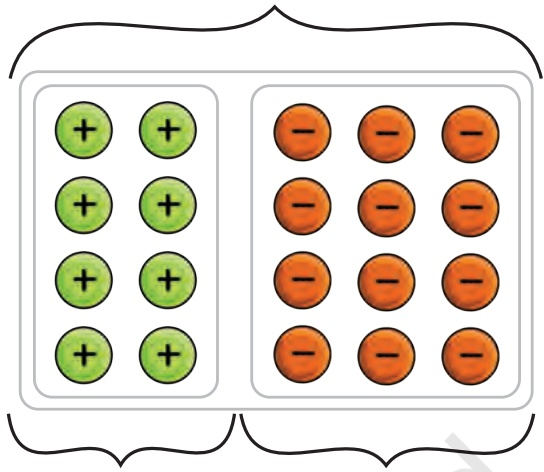
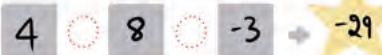

4 × 2

In the case of positive integers, we used a rectangular arrangement of objects to visually understand why the distributive property holds. We can use the same setup even in the case of integers by using green tokens for positive numbers and red tokens for negative numbers. For example, consider the following rectangular arrangement of tokens —

4 × (2 + (– 3))

We see that the overall arrangement represents 4 × (2 + (– 3)), and it is clear that this also equals the sum of 4 × 2 and 4 × (–3).

4 × (– 3)

Can you visually show the distributive property for an expression like –4 × (2 + (–3))? [**Hint:** Use the fact that multiplying a number by –4 is adding the inverse of the number 4 times.]

Thus, for any integers a, b, and c, we have

$$
a \times (b + c) = (a \times b) + (a \times c).
$$

## Pick the Pattern

Two pattern machines are given below. Each machine takes 3 numbers, does some operations and gives out the result.

Find the operations being done by Machine 1.

## MACHINE-1

## MACHINE-2

5

8

3

8

10

12

9

12

5

8

-3

16

3

$$
= 3
$$

10

2

$$
- 4 - 1 - 6 + 2
$$

$$
1 0 \cdots 1 2 \cdots 9 0
$$

$$
- 1 0 - 1 2 = 9 0
$$