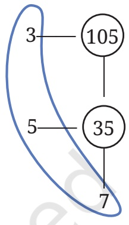

Each circled number is the product of the numbers that are to its left and below. For example, $30 = 2 \times 15, \quad 15 = 3 \times 5$ . Each time, a composite number is factorised so that, at least one factor is prime. We stop when we reach a prime number.

Can you write the prime factorisation of 105 and 30 using these two figures?

We collect the prime factors along the left and the one at the bottom. We then construct the prime factorisation as shown in the figure.

While carrying out factorisation, the circles are usually left out and the steps are carried out in this format:

$$
\begin{array}{c|ccc}3 & 105 &  \\\hline5 & 35 &  \\\hline& 7 &  \\\end{array}
$$

$$
\begin{array}{c|ccc}& 30 &  &  \\\hline3 & \boxed{15} &  &  \\\hline& 5 &  &  \\\end{array}
$$

$$
105 = 3 \times 5 \times 7
$$

Let us call this method the **division method**.

Try finding the prime factorisation of 1200 using the method above. If we had used the earlier method, our calculation would have been as follows:

$$
1200 = 40 \times 30 = 5 \times 8 \times 5 \times 6 = \ldots
$$

Which calculation is easier to carry out?

## Factors of a Number Using Prime Factorisation

From the prime factorisation of a number, we can construct all its factors. This can be used to simplify the procedure for finding the HCF of two numbers.

Consider the number 840 and its prime factorisation $2 \times 2 \times 2 \times 3 \times 5 \times 7 .$

Is $2 \times 2 \times 7 = 28$ a factor of 840?

## If yes, what should it be multiplied by to get 840?

To answer these questions, we can reorder the prime factors of 840 as follows (recall that reordering factors does not change the product):

$$
8 4 0 = ( 2 \times 2 \times 7 ) \times ( 2 \times 3 \times 5 ) .
$$

So,

$$
8 4 0 = 2 8 \times 3 0 .
$$

Thus, $( 2 \times 2 \times 7 ) = 2 8$ is a factor of 840, and it should be multiplied by 30 $( 2 \times 3 \times 5 )$ to get 840.