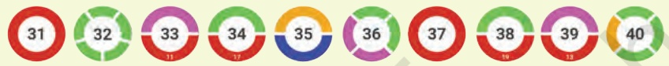
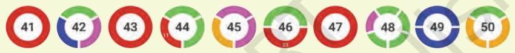
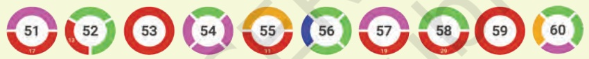
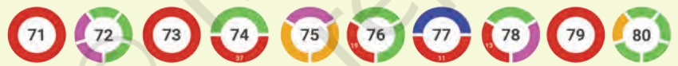

## ITs PUZZLE TIME!

**Mystery Colours!**

You might have noticed and wondered about these different circle designs around the page numbers on each page!

The picture below shows all the designs for the numbers from 1 to 100.

61 62 63 64 65 66 68 69 70

Try to decode the colour scheme for each number. There are several interesting patterns here. Share your observations with your classmates. Extending this scheme, colour the page numbers from 101 – 110.

