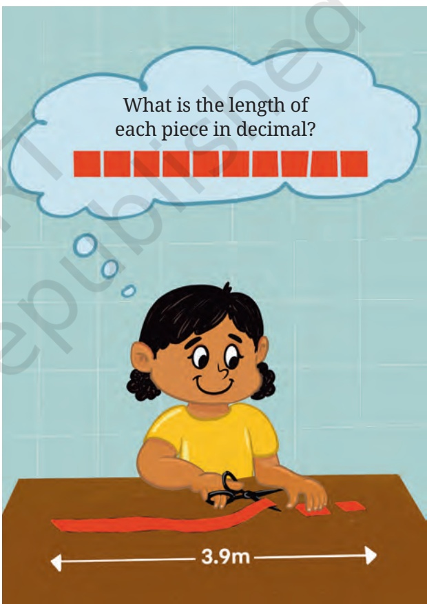

|  | × 10 | × 100 | × 1000 |
| --- | --- | --- | --- |
| 5.7 |  |  |  |
| 23.02 |  |  |  |
| 0.92 |  |  |  |
| 0.306 |  |  |  |
| 24.67 |  |  |  |

## 4.3 Decimal Division

**Example 6:** Anuja has a 3.9 m length of ribbon and she wants to cut it into 10 equal pieces. What is the length of each piece in decimal?

Since there are 10 pieces, we can find the length of each piece by dividing 3.9 by 10.

So, what is $3 . 9 \div 1 0 ?$

Let’s convert 3.9 into fraction $3.9 = \frac{39}{10}$ Hence, $3 . 9 ~ \div ~ 1 0$ is the same as dividing $\frac { 3 9 } { 1 0 }$ by 10.

Recall that, dividing a fraction by a divisor is the same as multiplying the fraction by the reciprocal of the divisor. The reciprocal of 10 is ${ \frac { 1 } { 1 0 } } .$

So, $\frac{39}{10} \div 10 = \frac{39}{40} \times \frac{1}{10} = \frac{39}{100} = 0.39.$

Thus, the length of each piece of ribbon is 0.39 m.

？ What is the length of each piece if the ribbon is cut into 100 equal pieces? $3.9 \div 100 = \frac{39}{10} \times \frac{1}{100} = \frac{39}{1000} = 0.039.$

When the ribbon is cut into 100 equal pieces, the length of each piece is 0.039 m.