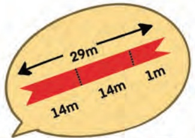

## What is 0.039 m in centimetres and millimetres?

By looking at these divisions, we can frame a simple rule for dividing decimals by 1, 10, 100, 1000, and so on.

When we divide a decimal by 1, 10, 100, 1000, and so on, we can just move the decimal point to the left by as many places as there are zeroes in the divisor!

| Decimal | ÷ 10 | ÷ 100 | ÷ 1000 | ÷ 10000 |
| --- | --- | --- | --- | --- |
| 18.7 | 1.87 | 0.187 | 0.0187 | 0.00187 |
| 21.1 |  |  |  |  |
| 0.13 |  |  |  |  |
|  |  | 2.146 |  |  |
|  |  |  |  | 0.0058 |

## Example 7: Neenu has 29 metres of red ribbon and wants to share it

equally with Anu. What is the length of ribbon that each of them will get?

Since the ribbon needs to be divided into two equal parts, each girl will get a piece of $2 9 \div 2$ metres.

If each of them gets 14 m, then 1 m remains. If we divide 1 m among the two, each will get another $\frac { 1 } { 2 }   \mathrm { m }$

## How do we convert $\frac { 1 } { 2 }$ into a decimal?

It is easy to express a fraction as a decimal if the denominator is 1, 10, 100, 1000, etc. So, can we find a fraction equivalent to $\frac { 1 } { 2 }$ with such a denominator?

$\frac{1}{2}=\frac{1\times 5}{2\times 5}=\frac{5}{10}$ (multiplying the numerator and denominator by 5).