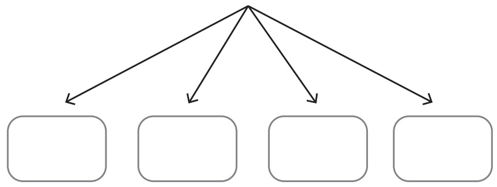
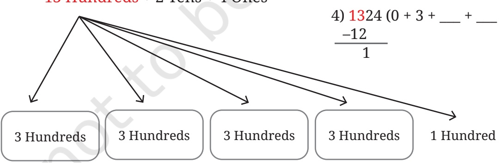

**Example 8:** Find the value of $1 3 2 4 \div 4 .$

1324 ÷ 4 Divide 1324 into 4 equal parts.

1 Thousand + 3 Hundreds + 2 Tens + 4 Ones

1 Thousand ÷ 4 Not possible without regrouping. Regroup 1 Thousand into 10 Hundreds. 10 Hundreds + 3 Hundreds = 13 Hundreds.

13 Hundreds + 2 Tens + 4 Ones

13 Hundreds ÷ 4 Each part gets 3 Hundreds, and 1 Hundred remains.

13 Hundreds + 2 Tens + 4 Ones

**Th H T** O

4) 1324 (0 + 3 + \_\_\_ +

3 Hundreds

3 Hundreds

3 Hundreds

3 Hundreds

1 Hundred

Regroup 1 Hundred into 10 Tens. 10 Tens + 2 Tens = 12 Tens.