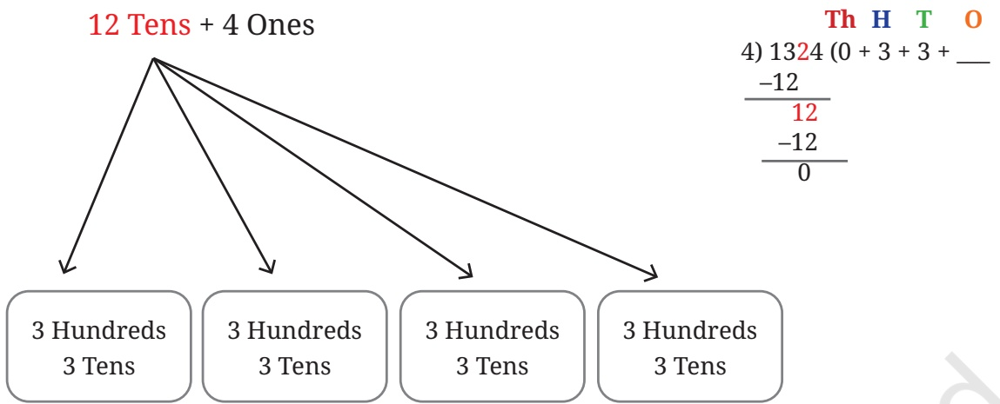
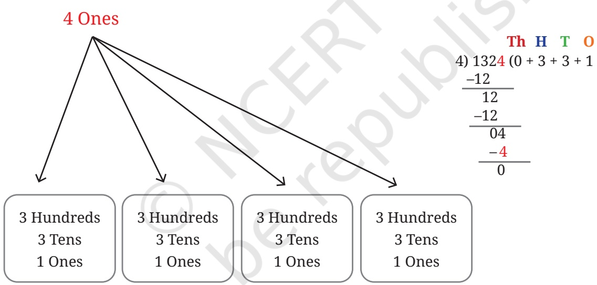

12 Tens ÷ 4 Each part gets 3 Tens.

4 Ones ÷ 4 Each part gets 1 Ones.

So, 1324 ÷ 4 = 0 Thousands + 3 Hundreds + 3 Tens + 1 Ones = 331.

We also call this division using place values as ‘**long division**’.

## Division with a Decimal Quotient

Now, let us use this understanding of long division to find the value of $1 3 2 5 \div 4 .$

1325 ÷ 4 Divide 1325 into 4 equal parts.

We can follow the same steps as in the previous problem.