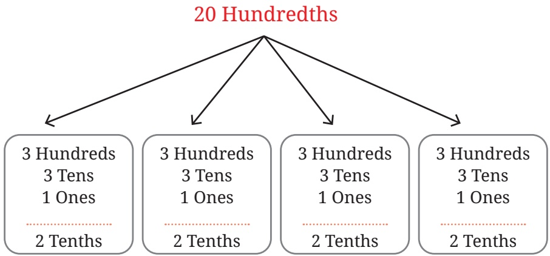
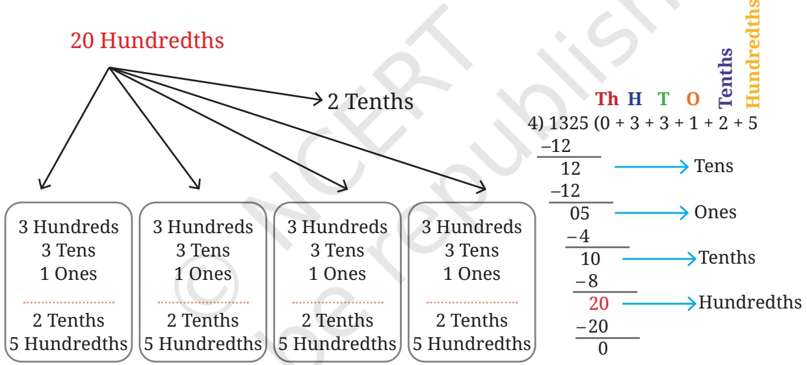

We are left with 2 tenths.

To divide 2 Tenths into 4 equal parts, we have to regroup them as 20 Hundredths.

20 Hundredths ÷ 4 Each part gets 5 Hundredths.

So, 1325 ÷ 4 = 0 Thousands + 3 Hundreds + 3 Tens + 1 Ones + 2 Tenths + 5 Hundredths. This we know is 331.25, thus,

$$
1325 \div 4 = 331.25.
$$

Can we verify this by finding an equivalent fraction for $\frac { 1 3 2 5 } { 4 } ?$

To get an equivalent fraction such that the denominator is of the form 1, 10, 100, 1000, and so on, we can multiply the numerator and denominator by 25.

$$
\frac{1325 \times 25}{4 \times 25} = \frac{33125}{100} = 331.25.
$$