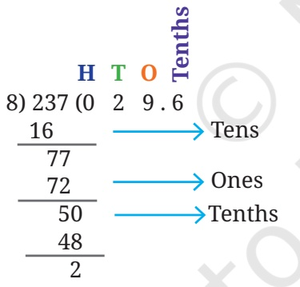
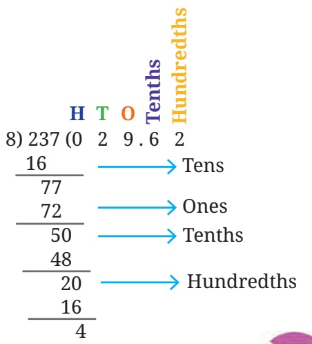

Thus, the procedure of division using place value can be extended to find quotients with decimal values. Ones can be regrouped as tenths, tenths can be regrouped as hundredths and so on.

**Example 9 :** Find the value of 237 ÷ 8.

237 ÷ 8 Divide 2 Hundreds + 3 Tens + 7 Ones into 8 equal parts.

To divide 2 Hundred into 8 equal parts we need to regrouped them as 20 Tens.

20 Tens + 3 Tens = 23 Tens.

23 Tens ÷ 8 2 Tens, and 7 Tens remain.

7 Tens can be regrouped as 70 Ones.

70 Ones + 7 Ones = 77 Ones.

77 Ones ÷ 8 9 Ones, and 5 Ones remain.

$$
\begin{array} { c } { \begin{array} { c } { \begin{array} { c } { \begin{array} { c } { \begin{array} { c } { \begin{array} { c } { \begin{array} { c } { \begin{array} { c } { \begin{array} { c } { \begin{array} { c } { \begin{array} { c } { \begin{array} { c } { \begin{array} { c } { \begin{array} { c } { \begin{array} { c } { \begin{array} { c } { \begin{array} { c } { \begin{array} {array { c } } { c } { \begin{array } { c } { \begin{array{array} { c } { \begin{array} {array \end{array} { c } { } \end{array } } } } \\ { \end{ \begin{array} {array} { c } { \begin{array} {array} \begin{array} { c } {array{ c } } { \begin{array{array} \begin{array} { c } {array{ c } } { \begin{array{array} \begin{array} { c } { c } { } \end{array } } } \\ { \begin{array{array} \begin{array} { c } {array{ c } } { \begin{array} { c } { \begin{array} { c } { \begin{array} { c } { \begin{array} { c } { \begin{array} { c } { \begin{array} { c } { } \begin{array{array} \end{array} { c } { } \begin{array{array} \end{array} { c } { } \begin{array} { c } { \begin{array} { c } { } \begin{array} { c } { \begin{array} { c } { } \end{ } \begin{array{array} \end{array} { c } } \end{array } } } \\ { \begin{array} { c } { \begin{array} {array} \begin{array} { c } { c } { } \begin{array{array} \begin{array} { c } { c } { } \end{ } \begin{array} { c } { } \begin{array} { c } { \begin{array} { c } { } \begin{array} { c } { \begin{array} { c } { } \end{ } \begin{array} { c } { } \end{ } \begin{array{ c } } { \begin{array} { c } { } \begin{ } \end{array { c } } \end{ } \end{array } } } \end{ c } \end{array } } } } } \end{ } } } \end{ } } } } \end{ } } } \end{ } } } } \end{ } } } } \end{ } } } } \end{ } } } } \end{ } } } \end{ } } } } \end{ } } } } } \\ { \end{ } } \end{array} } } \begin{array} {array} { c } { } { \begin{array} { c } } { \begin{array} { c } } { } { \begin{array} { c } } { c } { \begin{array} { c } } { c } { { } \begin{array} { c } { c } { } \begin{array} { c } { c } { } \end{array } { c } { } \begin{ c } {array } { c } { c } { } \end{array { c } } { c } \end{array { c } } \begin{array} { c } { c } { c } { } \begin{array} { c } { c } { c } \end{array { c } } \end{array { c } { c } } \end{array { c } } \begin{array} { c { c } { c } } \begin{array} { c { c } { c } { c } \end{array} { c } \begin{array} { c { c } } { c } \begin{array} { c } { c } { c } \end{array} { c { c } } \end{array { c } \begin{array} { c } { c } { c } \ \end{array} \end{array} \end{array} \end{array} \end{array} \end{array} \end{array} \end{array} \end{array} \end{array} \end{array} \end{array} \end{array} \end{array} \end{array} \end{array} \end{array} \end{array} \end{array} \end{array} \end{array} \end{array} \end{array} \end{array} \end{array} \end{array} \end{array} \end{array} \end{array} \end{array} \end{array} \end{array} \end{array} \end{array} \end{array} \end{array} \end{array} \end{array} \end{array} \end{array} \end{array} \end{array} \end{array} \end{array} \end{array} \end{array} \end{array} \end{array} \end{array} \end{array} \end{array} \end{array} \end{array}
$$

To divide 5 Ones into 8 equal parts we need to regroup them as 50 Tenths.

**When we regroup Ones into Tenths, we place a decimal point in the quotient.**

50 Tenths ÷ 8 6 Tenths, and 2 Tenths remain.

2 Tenths cannot be divided into 8 equal parts. So we need to regroup them as 20 Hundredths.

Remember, when we regroup Ones into Tenths we need to place a decimal point in the quotient.

20 Hundredths ÷ 8 2 Hundredths, and 4 Hundredths remain.

