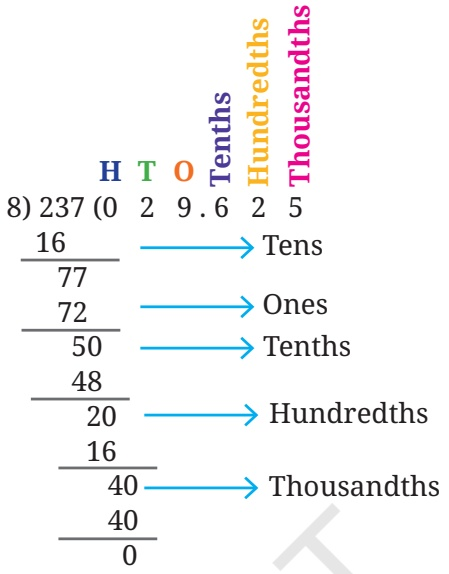
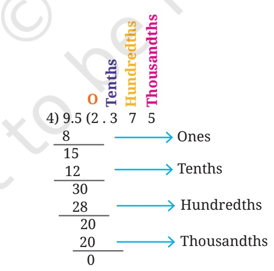

To divide 4 Hundredths into 8 equal parts we need to regroup them as 40 Thousandths.

40 Thousandths ÷ 8 5 Thousandths.

Thus, 237 ÷ 8 = 29.625.

## Division with a Decimal Dividend

**Example 10:** A shopkeeper has 9.5 kg of sugar and he wants to pack it equally in 4 bags. What is the weight of each bag of sugar?

To find the weight of each bag we need to divide 9.5 by 4.

Again, we place the decimal point in the quotient before we divide the tenths.Each bag of sugar weighs 2.375 kg.