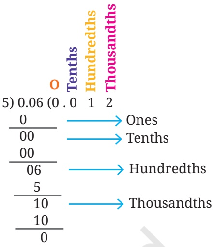

**Example 11:** What is the value of $0 . 0 6 \div 5 ?$ 0.06 0 Ones + 0 Tenths + 6 Hundredths $0 { \mathrm { ~ O n e s } } \div 5 \rightarrow 0 { \mathrm { ~ O n e s } } .$

When we move from Ones to Tenths we need to place the decimal point in the quotient. 0 Tenths $\div 5 \rightarrow 0$ Tenths.

6 Hundredths $\div 5 \rightarrow 1$ Hundredths, and 1 Hundredth remains. We need to regroup 1 Hundredth into 10 Thousandths.

10 Thousandths $\div 5 \rightarrow 2$ Thousandths. So, the quotient is 0.012.

## Figure it Out

1. Find the quotient by converting the denominator into 1, 10, 100 or 1000 and verify the solution by the long division method (division by place value). (a) $\frac { 1 8 } { 5 }$ (b) $\frac{415}{-4}$ (c) $\frac { 1 2 1 7 } { 2 }$ (d) $\frac{4827}{8_{ 尐 }}$

2. Choose the correct answer:

(a) $\frac { 1 5 2 6 } { 4 }   =$ (i) 38.15 (ii) 380.15 (iii) 381.5 (iv) 381.05

(b) $\frac{3567}{8} =$ (i) 4458.75 (ii) 44.5875 (iii) 445.875 (iv) 4458.75

3. What is the quotient? (a) $132 \div 4 =$ (b) $13.2 \div 4 =$ (c) $1.32 \div 4 =$ (d) $0.132 \div 4 =$

Remember, when we regroup Ones into Tenths we need to place a decimal point in the quotient.

4. What is the quotient? (a) $126 \div 8 =$ (b) $12.6 \div 8 =$ (c) $1.26 \div 8 =$ (d) $0.126 \div 8 =$ (e) $0.0126 \div 8 =$

