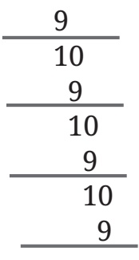
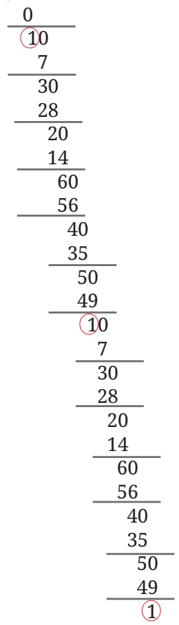

**Step 3:** Regroup 1 Tenths as 10 Hundredths. 10 Hundredths $\div   3 \rightarrow 3$ Hundredths , and 1 Hundredths remain. 3) 10 (3 333

3) 10 ( 3.333 ...

**Step 4:** Regroup 1 Hundredths as 10 Thousandths. 10 Thousandths ÷ 3 3 Thousandths, and 1 Thousandths remain. Regroup 1 Thousandths as 10 TenThousandths.

This never seems to end! Each time we divide by 3, there is a remainder of 1.

## Will this process end?

In long division, we see that at each step we get a remainder of 1. So, the process will never end!

So, 10 ÷ 3 cannot be expressed using a finite number of digits in the decimal form.

$$
10 \div 3 = 3.333 \ldots
$$

There are decimal divisions where the quotient never ends! We will explore such numbers in greater detail in a later class.

## Can you find the quotients of 10 ÷ 9, and 100 ÷ 11?

7) 1 ( 0.142857142857...

Now divide 1 by 7 (1 ÷ 7).

Will this end?

Note all the remainders we get. It starts with 1, then 3, then 2, then 6, and so on. Let us represent this as a chain.

$$
\begin{array}{l}1 \xrightarrow{ \text{1 }} 3 \xrightarrow{ \text{2 }} 2 \xrightarrow{ \text{3 }} 6 \xrightarrow{ \text{4 }} 4 \xrightarrow{ \text{5 }} 5 \\5 \xleftarrow{ \text{3 }} 4 \xleftarrow{ \text{4 }} 6 \xleftarrow{ \text{1 }} 2 \xleftarrow{ \text{2 }} 3 \xleftarrow{ \text{1 }} 1 \\\downarrow \\1 \xrightarrow{ \text{1 }} 3 \ldots\end{array}
$$

What do you observe? Can you explain why this division never ends?

Not only do the remainders repeat in a cycle, the digits of the quotient also repeat in a cycle! 0.142857 142857 14…

## A Magic Number: 142857

Let us consider the number 142857 that arose when dividing 1 by 7. Multiply 142857 by numbers from 1 to 6.

