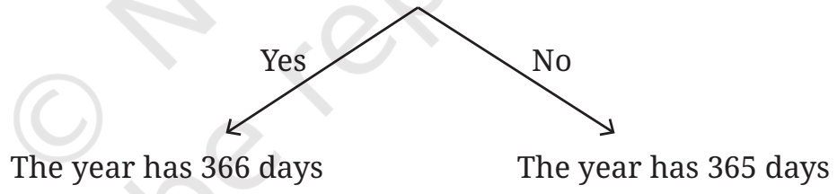

So, the good people who designed calendars decided that they will not add 1 extra day in every hundredth year!

## Making Another Adjustment

Is the year divisible by 100?

Yes

No

The year has 365 days

Is the year divisible by 4?

Yes

No

? Can you write an expression for the number of days in 100 calendar years with this new adjustment?

We saw that there are 25 years divisible by 4 in 100 years. 100 is also divisible by 4, but we have to exclude it. So only 24 years have 366 days, and the rest (76 years) have 365 days. So the expression can be written as,

$$
\begin{aligned}\left( \frac{100}{4} - \frac{100}{100} \right) \times 366 + (100 - \left( \frac{100}{4} - \frac{100}{100} \right)) \times 365 \\= (24 \times 366) + (76 \times 365) = 36, & 524 \;  days. \end{aligned}
$$

This is close to 36524.22 days but is it close enough? What happens after 1000 years with this adjustment?