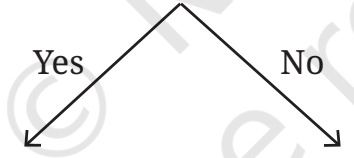
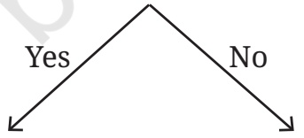
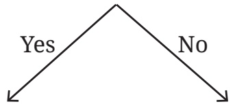

If we follow this new scheme of adding 1 day every four years, but not in the 100th year, the number of calendar days in 1000 years is

$$
3 6 5 2 4 \times 1 0 = 3 , 6 5 , 2 4 0 \; \mathrm { d a y s } .
$$

The number of days the Earth takes to go around the Sun 1000 times is $1 0 0 0 \times 3 6 5 . 2 4 2 2 = 3 , 6 5 , 2 4 2 . 2 \mathrm { ~ d a y s } .$

So, there is a difference of 2.2 days.

To bridge this gap, it was decided that every 400th year would be a leap year!

Add an extra day every 400th year.

Is the year divisible by 400?

The year has 366 days

Is the year divisible by 100?

The year has 365 days Is the year divisible by 4?

The year has 366 days The year has 365 days

With this scheme, let us calculate the number of days in 1000 calendar years.