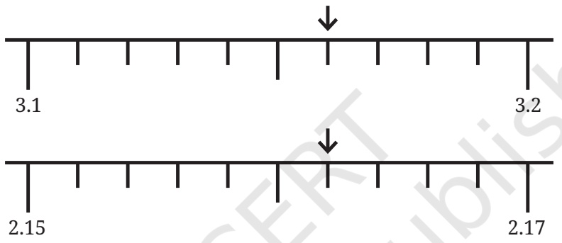

？ Do you wonder how people figured out that the Earth completes one revolution around the Sun in exactly 364.2422 days?

? Investigate how traditional calendars in India managed to consistently align the days in the calendar with astronomical events like the Earth going around the Sun or even the positions of the stars in the sky accurately.

## Figure it Out

1. A 210 gram packet of peanut chikki costs ₹70.5, while a 110 gram packet of potato chips costs ₹33.25. Which is cheaper?

2. Write the decimal number at the arrow mark:

3. Shyamala bought 3 kg bananas at ₹30/- per kg. She counted 35 bananas in all. She sells each banana for ₹5/-. How much profit does she make selling all the bananas?

4. A teacher placed textbooks that are 2.5 cm thick on a bookshelf. The teacher wanted to place 80 textbooks on the shelf. The bookshelf is 160 cm long. How many books could be placed on the shelf? Was there any space left? If yes, how much?