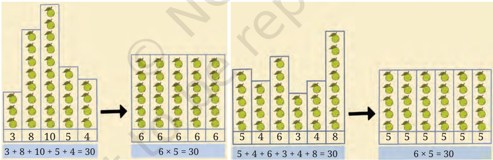

The **Average** or **Arithmetic Mean** (A.M.), or simply **Mean**, is calculated as follows:

$$
Mean  = \frac{ Sum of all the values in the data }{ Number of values in the data }
$$

## Average as Fair-Share

The average can also be understood as fair-share or equal-share.

？ Shreyas and 4 of his friends have collected the following numbers of guavas: 3, 8, 10, 5, and 4. Parag and 5 of his friends have collected the following numbers of guavas: 5, 4, 6, 3, 4, and 8. Each group will share their guavas equally amongst themselves. In which group will each member get a bigger share of guavas?

To find this out, we first find out how many guavas each group has collected. Then we divide this total by the number of people in the group to get each member’s share.

Shreyas’s group has collected $3+8+10+5+4=30$ guavas. Each member of Shreyas’s group gets $30 \div 5 \equiv 6$ guavas.

Parag’s group has collected $5+4+6+3+4+8=30$ guavas. Each member of Parag’s group gets $30 \div 6 = 5$ guavas.

So, the members of Shreyas’s group get 1 more guava each than the members of Parag’s group.

Vaishnavi tracks the number of Hibiscus flowers blooming each day. The data for the last few days’ is 2, 7, 9, 4, 3. What is the average number of Hibiscus flowers blooming per day in Vaishnavi’s garden?

$$
The average = (the total number of $\mathit { H i b i s c u s }$ follows $\begin{array} { r } { \mathrm { ~  ~ \dot { ~ } ~ } } \end{array}$ ) \mathrm { ~  ~ \dot { ~ } ~ } \mathrm { ~  ~ \dot { ~ } ~ }$ (number of days) $\begin{array} { r } { = ( 2 + 7 + 9 + 4 + 3 ) \div 5 } \\ { = 5 . } \end{array}$
$$

