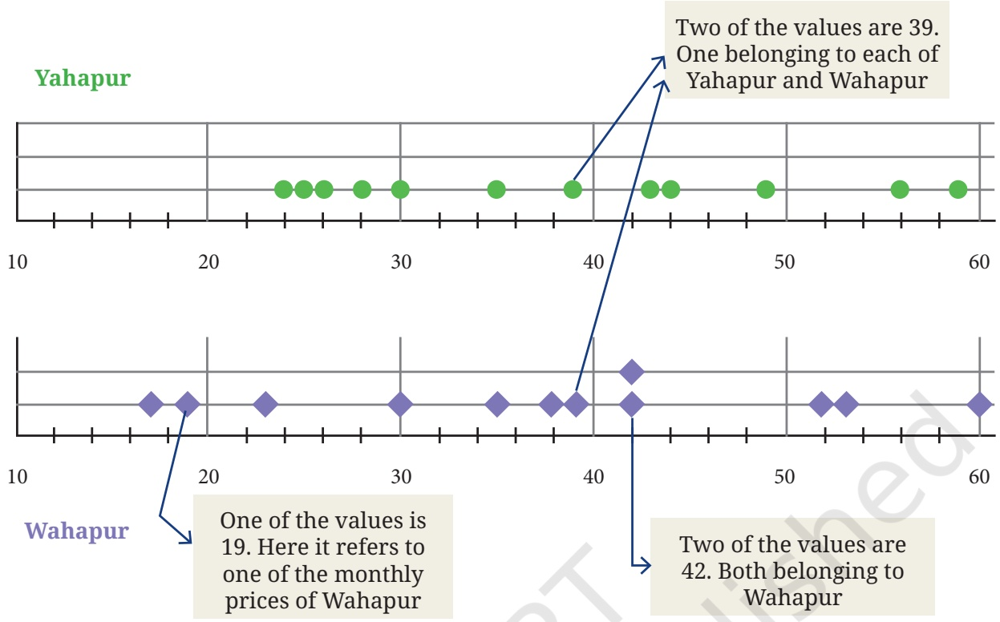

The prices in Yahapur are in green and those in Wahapur are in purple. The horizontal line shows the prices from 10 to 60 (instead of starting from 0 as there are no values from 0 – 10 or above 60). The dots on the vertical line give the number of occurrences of a data value. Notice the equal spacing between the units along the horizontal as well as the vertical lines.

Does this visualisation capture all the data presented in the tables earlier?

？ Looking at it, can we tell the price of onions in Yahapur in the month of January?

This method of presentation orders or sorts the data, but it loses the original (month-wise) sequence of the values. However, it allows us to group the data however we wish, just as Vishal did. For instance, there are 2 data values between 11 – 20 for Wahapur, while Yahapur has none. This representation makes it easier to observe the variation in the data — where and how the data is clustered or spread out. We can easily see that the prices in Wahapur are more spread out than those in Yahapur. It is also easy to spot the highest and lowest values.

We can also use the average as one of the ways to compare the prices at these two places.