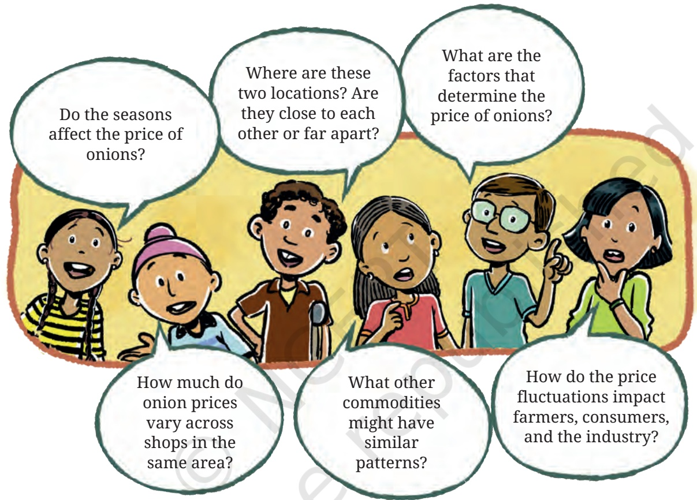

? Find the average price of onions at Yahapur and Wahapur.

A statement such as, “The price of onions is ₹35 per kilo”, may not trigger any further questions. But looking at variations in data, like the prices of onions over a year in Yahapur and Wahapur, can spark one’s curiosity. For example, one might be curious to know more about the two locations.

You might wonder —

Do the seasons affect the price of onions?

Where are these two locations? Are they close to each other or far apart?

What are the factors that determine the price of onions?

What other commodities might have similar patterns?

## What else do you wonder about?

You can discuss questions that you are curious about with your peers, teachers, or family members to find answers.

Observing and trying to make sense of data can reveal interesting things. It can also trigger our curiosity in different directions.

## Averages Around Us

The Arithmetic Mean is frequently used in statistics, mathematics, experimental sciences, economics, sociology, sports, biology and diverse