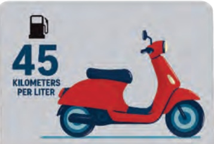

disciplines as a representative of data. It is popular partly because the definition of the arithmetic mean is simple and easy to understand. Some statements involving averages in different scenarios are shown below:

The average rainfall per day in Jharkhand in the month of July is 37.2mm.

My scooty's average mileage this year is about 45 kilometers per liter.

Wheat yield averages 4.7 tonnes per hectare in Punjab vs. 2.9 tonnes per hectare in Bihar.

Smartphone users check their phone 58 times a day on average.

An average Indian citizen generates 0.45 kg of waste per day.

3126 is the average number of Indian long films released annually between 2017 – 2024.

## Outliers and Medians

Does the average always give a reasonable summary of the values in a collection? If not, what is an alternative? Let us find out.

## Height of a Family

follows:

Yaangba’s family: 169 cm, 173 cm, 155 cm, 165 cm, 160 cm, 164 cm. Poovizhi’s family: 170 cm, 173 cm, 165 cm, 118 cm, 175 cm.

Find the average height of each family. Can we say that Yaangba’s family is taller than Poovizhi’s family?