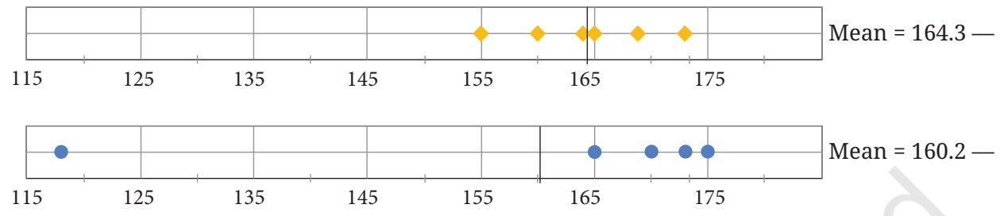
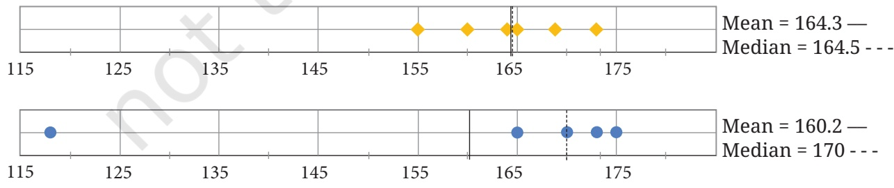

The average height of Poovizhi’s family (160.2 cm) is less than that of Yaangba’s family (164.3 cm). Although most members in Poovizhi’s family are taller, their family’s average height is less because one child is much younger and not as tall as the rest of the family. Their average height, 160.2 cm, is less than the heights of 4 out of 5 members. Here, the average doesn’t seem to represent the data very well.

？ Can you think of any other number that can represent the data better?

One way is to sort the data and pick the number in the middle. This number is called the **Median**.

To find the median height of Poovizhi’s family, we first sort the heights —

$$
1 1 8 , 1 6 5 , 1 7 0 , 1 7 3 , 1 7 5 .
$$

The middle number in this sorted data is 170. Therefore, the median height is 170 cm.

Let us find the median height of Yaangba’s family. Sorting the heights, we get

$$
1 5 5 , 1 6 0 , 1 6 4 , 1 6 5 , 1 6 9 , 1 7 3 .
$$

Since the median is the number in the middle, it will have an equal number of values less than it and greater than it. This data does not have a single middle number because it has an even number of values (6). In such cases, we take the average of the two middle numbers in the sorted data. Therefore, the median height of Yaangba’s family is (164 + 165) ÷ 2 = 164.5 cm.

？ In this case, does the median represent the heights of the families better than the average?