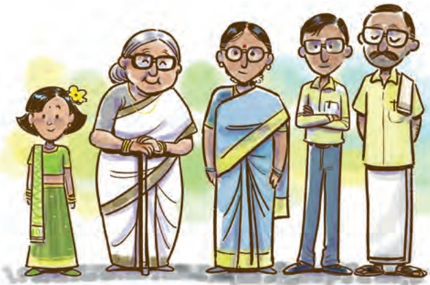
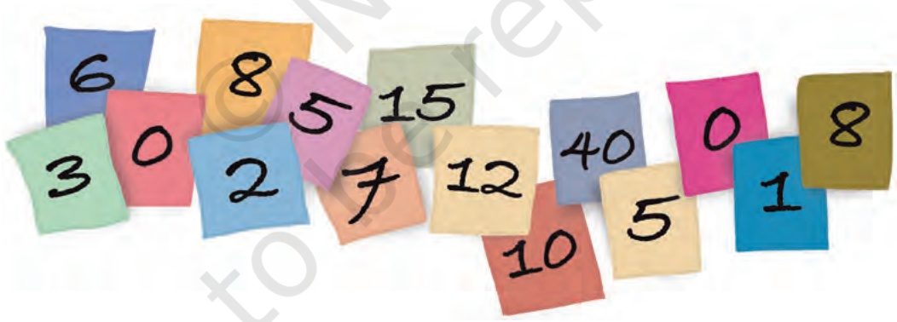

In Poovizhi’s family, the height of the youngest child is quite different from the heights of the rest of the family. We call such a value an **outlier**. Outliers are values which significantly deviate from the rest of the values in the data.

Notice how the mean and the median are close to each other in Yaangba’s data, in the absence of any outlier.

In Poovizhi’s data, because of the outlier, the mean is much lower than the median.

? Find the mean and median in Poovizhi’s data without the outlier value 118. What change do you notice?

## Are you a bookworm?

？ After the summer vacation, a class teacher asked his class how many short stories they had read. Each student answered the number of stories read on a piece of paper, as shown below. Find the mean and median number of short stories read. Before calculating them, can you guess whether the mean will be less than or greater than the median?

Mark the data, the mean, and the median on the dot plot below.

|  |  |  |  |  |  |  |  |
| --- | --- | --- | --- | --- | --- | --- | --- |
|  |  |  |  |  |  |  |  |
| C |  |  |  |  |  |  |  |
|  |  |  |  |  |  |  |  |

5

10

20

40

The median value 6 means that half of the class members have read 6 or more stories.