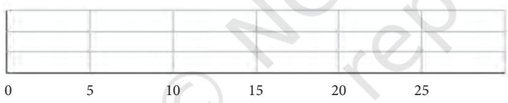
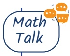

? Which of the values would you consider an outlier?

？ Find the mean and median in the absence of the outlier. What change do you notice?

The average may not always be an appropriate representative of data that has outliers. A very high or a very low outlier can significantly impact the sum, thus affecting the average. For example, the 118 cm height in Poovizhi’s family is an outlier at the lower end of the data. And the count of 40 short stories read is an outlier at the higher end of the data. In these cases, we saw that the median was not affected much by the outliers.

## Are We on the Same Page?

Do you read newspapers? Have you noticed how many pages a newspaper has on different days of the week — is it the same or different?

The list below shows the number of pages for a particular newspaper from Monday to Sunday: 16, 18, 20, 22, 26, 16, 10.

Mark the data, the mean, and the median on the dot plot below.

In the three examples we considered — the heights, short-stories, and newspaper pages — observe the variability in data when:

(a) the mean and median are close to each other

(b) the mean and median are comparatively far apart, with mean < median

(c) the mean and median are comparatively far apart, with mean > median

When the data is more balanced or uniformly spread out the mean, and the median appear to be close to each other. When the outlier is on the lower end, the mean appears to shift in that direction, i.e., mean < median. When the outlier is on the higher end, the mean appears to shift in that direction, i.e., mean > median.