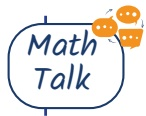
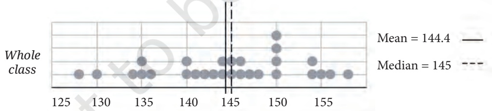
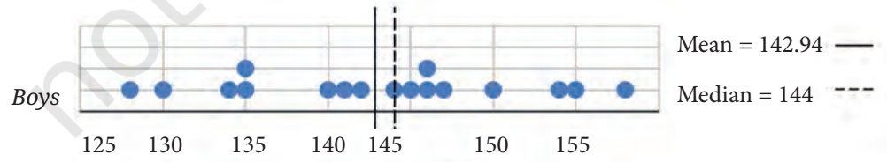
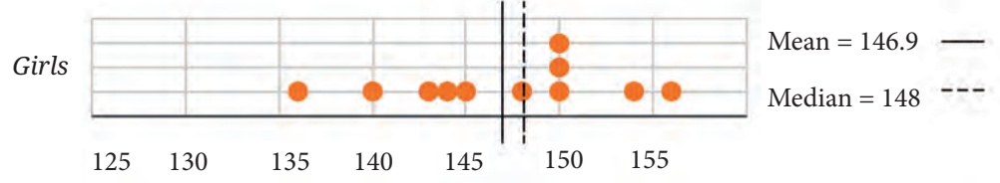

？ Discuss the effect on the mean and median when outliers are present on both sides. You may take some example data to examine and explain this.

Mean and Median are called measures of central tendency, i.e., the tendency of the values to pile up around a particular value. In other words, they represent the ‘centre’ of the data.

## Of Ends and the Essence

As we have just seen, the mean and the median can give different perspectives on the data. As part of analysing data, it can also be valuable to look at the variability in the given data, i.e., its extremes (minimum and maximum values).

## How Tall is Your Class?

Suppose you are asked the question, “How tall is your class?” What would you say?

The table below shows the heights of students in a Grade 5 class in centimeters.

<strong><u>Boys</u></strong> <u>147, 135, 130, 154, 128, 135, 134, 158, 155, 146, 146, 142, 140, 141, 144, 145, 150</u> <strong><u>Girls</u></strong> <u>143, 136, 150, 144, 154, 140, 145, 148, 156, 150, 150</u>

We can visualise the data using a dot plot, identify the ends and patterns, and look at the variability. We can also find the measures of central tendency. The dot plot for the whole class, followed by the dot plots for boys and girls, respectively, are shown. The mean and the median are also shown for each collection.

