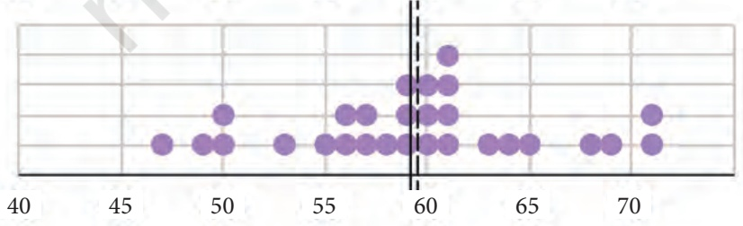
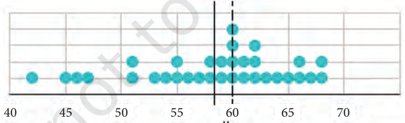

? What can we infer from the dot plots and the central tendency measures? The following points can help answer the question of how tall the class is.

The boys’ heights are more spread out and are between 128 and 158. The girls’ heights lie between 136 and 156. Both the tallest and shortest in the class are boys.

Yet, the boys’ average height is less than the whole class average, and also less than the girls’ average height. We can say girls are taller than boys in this class. Of course, this doesn’t mean every girl is taller than every boy!

For boys’ heights, mean < median (142.94 < 144) indicating a small influence of values on the lower side. For girls’ heights too, mean < median (146.9 < 148) indicating a small influence of values on the lower side.

? How many students are taller than the class’ average height?

How many boys are taller than the class’ average height?

## How long is a minute?

Two groups of children were asked to estimate the length of 1 minute. They start by closing their eyes and then open when they think 1 minute has passed. Of course, they are not supposed to count while their eyes are closed. The dot plots below show after how many seconds the children opened their eyes.

? Discuss how well both the groups fared at this activity. Describe and compare the variability in data and their central tendency.

