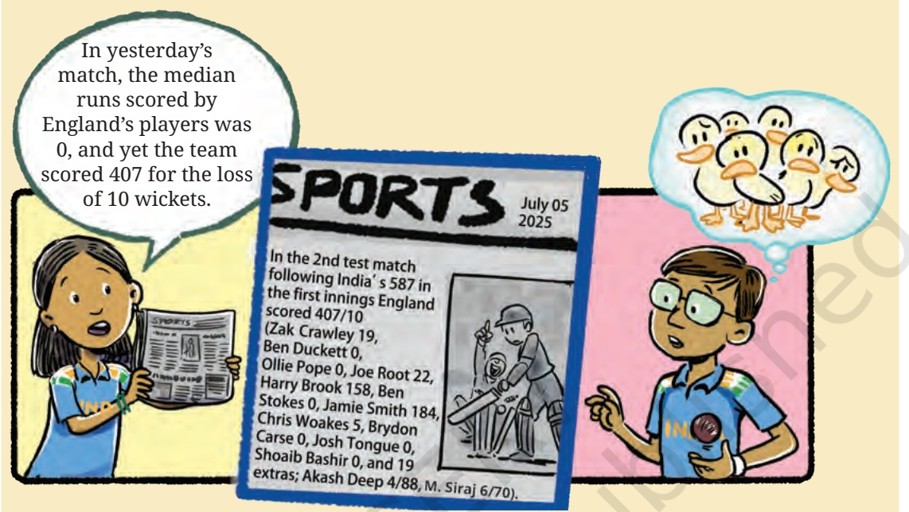

## Zero Median Runs Scored!

In a cricket match, can a team’s median runs scored by a player be 0 but the team’s total score be 407/10?

In yesterday’s match, the median runs scored by England’s players was 0, and yet the team scored 407 for the loss of 10 wickets.

## SPORTS July 05 2025

In the 2nd test match following India's 587 in the first innings England scored 407/10 (Zak Crawley 19, Ben Duckett 0. Ollie Pope 0, Joe Root 22. Harry Brook 158, Ben Stokes 0, Jamie Smith 184 Chris Woakes 5, Brydon Carse 0, Josh Tongue 0. Shoaib Bashir 0, and 19 extras; Akash Deep 4/88, M.

Accounting for the extras, the average runs scored by a player in this innings is (407 – 19) ÷ 11 = 35.27.

## Zero vs. No value

Suppose a player scores 57, 13, 0, 84, — , 51, 27 in a series. Notice that the player played Match 3 and scored 0 runs whereas the player did not play Match 5. So, we consider the total number of matches to be 6 and not 7. We calculate their average runs scored per match as (57 + 13 + 0 + 84 + 51 + 27) ÷ 6.

Sita has a mango tree in her backyard. The number of mangoes the tree gave every month over the last year, from January to December, is 0, 0, 8, 24, 41, 16, 5, 0, 0, 0, 0, 0 respectively. If we want to find the mean or median number of mangoes per month, it would be appropriate to consider only the (summer) months when mangoes are expected to grow.