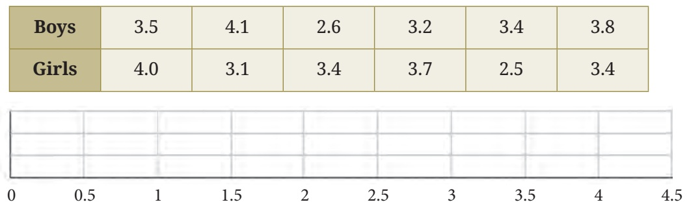
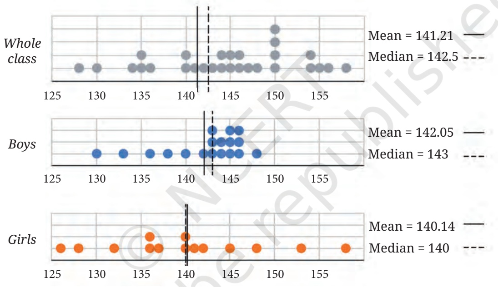
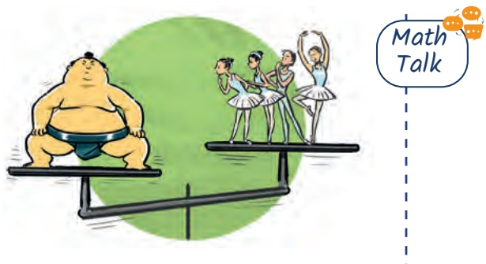

| Boys | 3.5 | 4.1 | 2.6 | 3.2 | 3.4 | 3.8 |
| --- | --- | --- | --- | --- | --- | --- |
| Girls | 4.0 | 3.1 | 3.4 | 3.7 | 2.5 | 3.4 |

6. The dot plots of heights of another section of Grade 5 students of the same school are shown below. Can you share your observations? What can we infer from the dot plots and the central tendency measures?

? Compare the heights of the two sections. Share your observations.

7. The weights of some sumo wrestlers and ballet dancers are: Sumo wrestlers: 295.2 kg, 250.7 kg, 234.1 kg, 221.0 kg, 200.9 kg. Ballet dancers: 40.3 kg, 37.6 kg, 38.8 kg, 45.5 kg, 44.1 kg, 48.2 kg. Approximately how many times heavier is a sumo wrestler compared to a ballet dancer?

