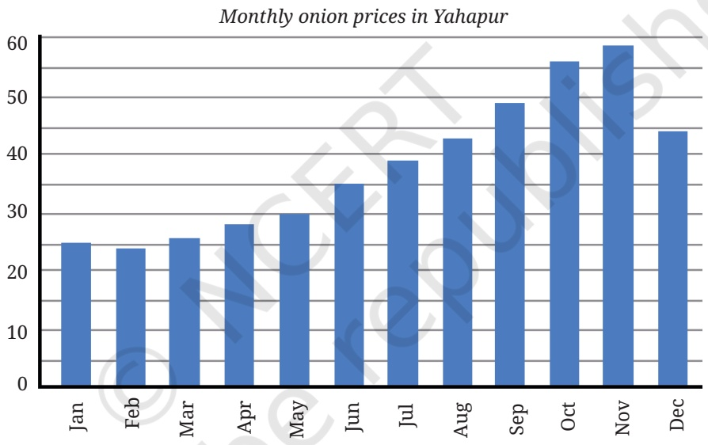
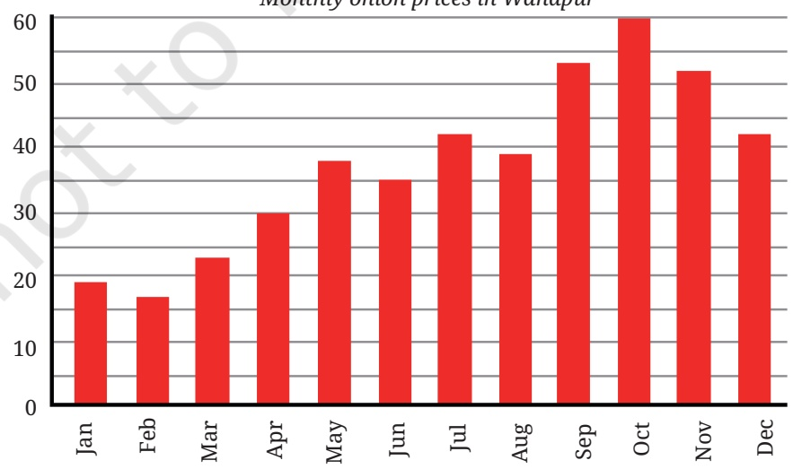

## 5.3 Visualising Data

We can often understand data more clearly if it is presented as a picture. This is called **data visualisation**. Last year, we saw how to visualise data using graphs. Let us explore visualisation further.

## Clubbing the Columns

Monthly onion prices in Wahapur

Earlier, we looked at the monthly onion prices in Yahapur and Wahapur.

|  | Jan | Feb | Mar | Apr | May | Jun | Jul | Aug | Sep | Oct | Nov | Dec |
| --- | --- | --- | --- | --- | --- | --- | --- | --- | --- | --- | --- | --- |
| Yahapur | 25 | 24 | 26 | 28 | 30 | 35 | 39 | 43 | 49 | 56 | 59 | 44 |
| Wahapur | 19 | 17 | 23 | 30 | 38 | 35 | 42 | 39 | 53 | 60 | 52 | 42 |

Two column graphs for this data are given below.

