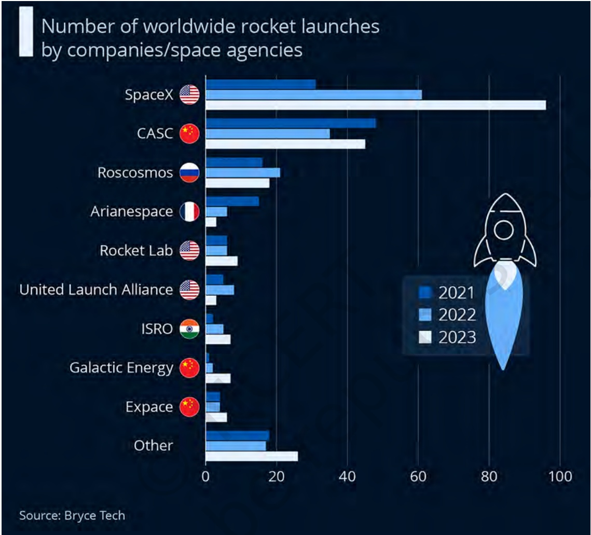

launched using rockets. Look at the graph below showing the number of worldwide rocket launches by different organisations.

？ Share your observations (you may take the teacher's help to identify the countries these organisations belong to).

Source: https://www.statista.com/chart/29410/number-of-worldwide-rocket-launches-by-companies-and-space-agencies/

Often there is a lot of information in graphs understand. We can follow a 2-step process to simplify making sense of the data in graphs.

## Step 1: Identify what is given

Notice how the graph is organised, what scale is used, and what patterns the data shows.

I wish they had shown guidelines for 5, 10, and 15 along the horizontal line. It would help in estimating the smaller numbers.

