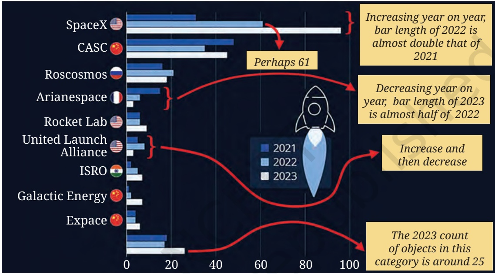

For each organisation, the numbers of rocket launches for the years 2021, 2022, and 2023 are shown as three adjacent bars. The scale used is 1 unit length = 20 rockets. Notice the numbers at the bottom.

The ‘Others’ category indicates multiple organisations worldwide that are clubbed together to keep the graph short.

Note that in the double bar graph of onion prices, the months are shown in order, i.e., January to December, to observe the change over time, whereas in this case, a change in the order of organisations does not affect the meaning.

## Step 2: Infer from what is given

Analyse and interpret each of your observations.

We can say that the USA, China, and Russia are the leading rocket launching countries in the given time period.

SpaceX launched about twice the number of rockets in 2022 compared to 2021. And it launched about 35 more rockets in 2023 compared to 2022.

The number of rockets launched by Arianespace decreased every year.

United Launch Alliance launched more rockets in 2022 than in 2021. They launched fewer rockets in 2023 than in both the years 2022 and 2021.

Other organisations launched about 25 rockets in 2023.