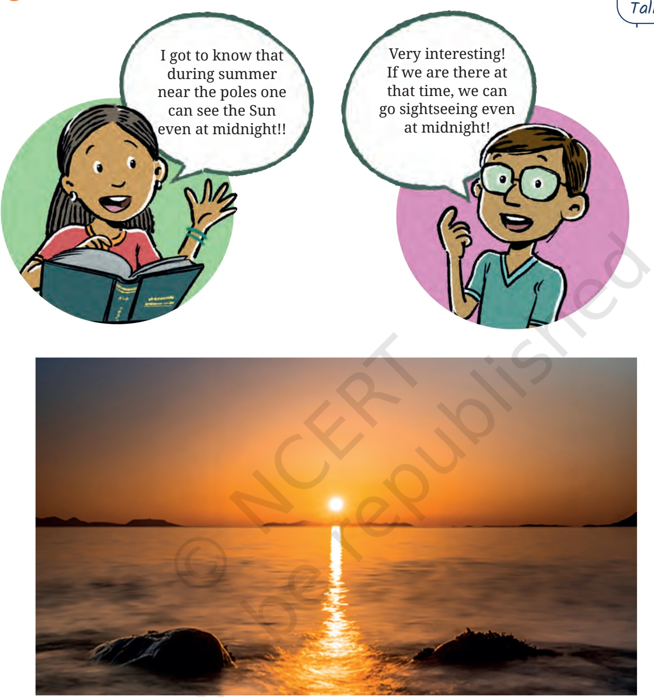

## Is there anything more that you wish to explore?

I got to know that during summer near the poles one can see the Sun even at midnight!!

Very interesting! If we are there at that time, we can go sightseeing even at midnight!

©timeanddate.com/Brendan Goodenough The Midnight Sun at Andøya, Norway.

## All it Takes is a Minute

Have you ever missed watching a cricket match? You can catch up in a minute by looking at a graph. You might have seen graphs like the following one.