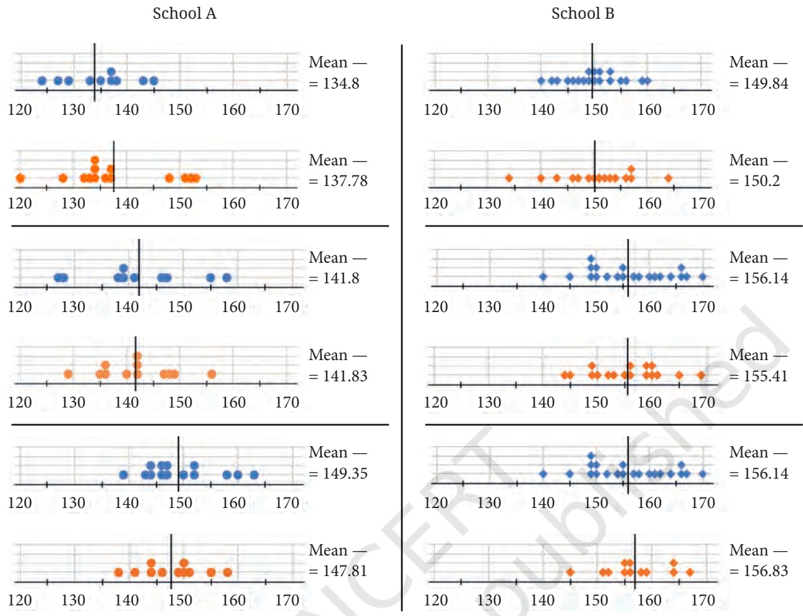

Looking at this data, you might wonder:

“Why is there a considerable difference in heights in the same grades across these two schools?”

“Where are these schools located?”

“How tall are students in Grades 6 to 8 in my school?”

“What is the average height of all Grade 6 boys and girls?”

We see that men are taller than women in general. But what about the heights of boys and girls? Are boys taller than girls? Well, just by looking at the data of one or two schools, we cannot generalise for all children in our country, or around the world.

Let us look at some data (based on a survey) of the heights of boys and girls of different ages in India over time. The following table shows the average heights of boys and girls (in centimeters) across ages 5 to 19 in the years 1989, 1999, 2009, and 2019. In each year, the first column shows boys’ heights and the second column shows girls’ heights.