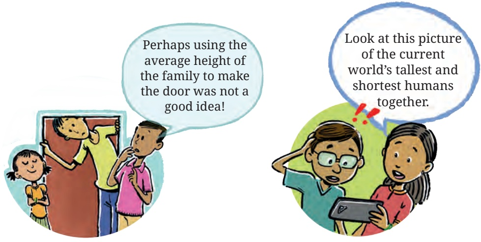
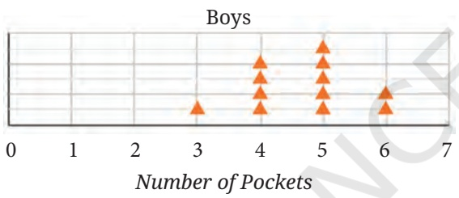
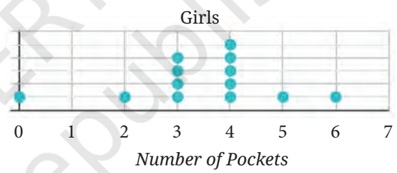

A Mean Decision!

## Figure it Out

1. The dot plots below show the distribution of the number of pockets on clothing for a group of boys and for a group of girls.

Based on the dot plots, which of the following statements are true?

(a) The data varies more for the boys than for the girls.

(b) The median number of pockets for the boys is more than that for the girls.

(c) The mean number of pockets for the girls is more than that for the boys.

(d) The maximum number of pockets for boys is greater than that for the girls.

2. The following table shows the points scored by each player in four games:

| Player | Game 1 | Game 2 | Game 3 | Game 4 |
| --- | --- | --- | --- | --- |
| A | 14 | 16 | 10 | 10 |
| B | 0 | 8 | 6 | 4 |
| C | 8 | 11 | Did not play | 13 |