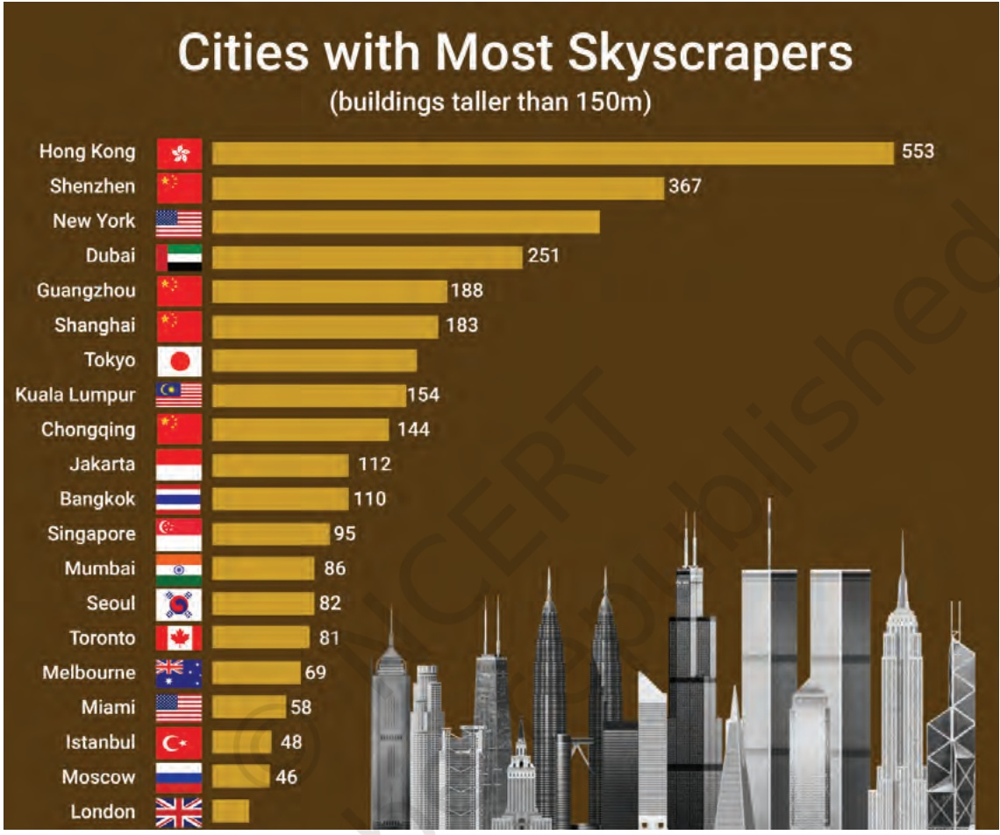

(c) The mean height of students in the other section is more than 154.2 cm.

(d) The mean height of students in the other section cannot be determined.

8. Standing tall in the storm.

(a) Write estimated values for the number of skyscrapers in New York, Tokyo, and London.

(b) Are the following statements valid?

(i) Only 12 cities have more skyscrapers than Mumbai.

(ii) Only 7 cities have fewer skyscrapers than Mumbai.

(iii) The tallest building in the world is in Hong Kong.

9. Estimate and then measure the objects listed in the following table. Draw a double bar graph based on the data. How accurate were your estimates? Find the average difference between the estimated and measured values.