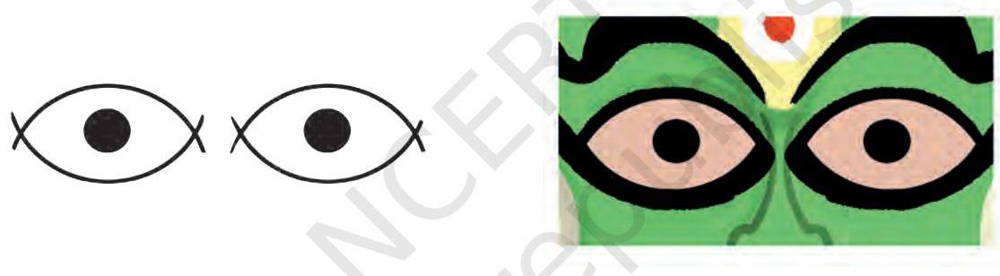
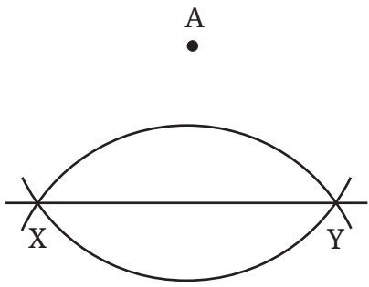

## 6 CONSTRUCTIONS AND TILINGS

0789CH06

## 6.1 Geometric Constructions

**Eyes**

Do you recall the ‘Eyes’ construction we did in Grade 6?

Of course, eyes can be drawn freehand, but we wanted to construct them so that the lower arc and upper arc of each eye look symmetrical.

We relied on our spatial estimation to determine the two centres, A

and B (see the figure), from which we drew the lower arc and upper arc respectively.

The arcs define a line XY that ‘supports’ the drawing though it is not part of the final figure. We can start with this supporting line and systematically find the centres A and B.

For the eye to be symmetrical, or for the supporting line to be the line of symmetry, the upper and lower arcs should have the same radius. In other words, we must have AX = BX.

Since AX = AY and BX = BY, this means

$$
AX = AX = BX = BX
$$

● B