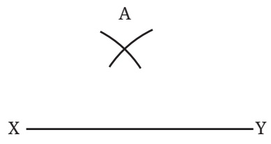
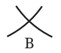
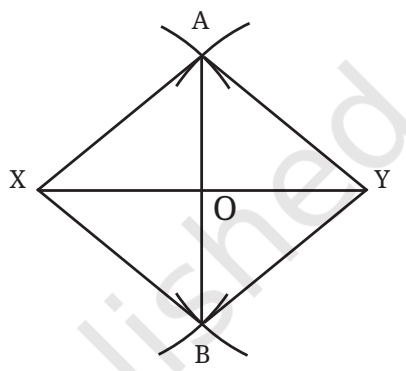
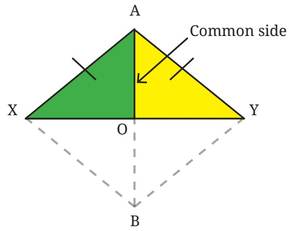

How do we find such A and B?

From X and Y, draw arcs above and below XY, with the same radii.

The two points at which the arcs meet, above and below XY, give us A and B, respectively.

Use this to construct an eye.

In Fig. 6.1, join A and B with a line. Where does AB intersect XY, and what is the angle formed between them?

We observe that AB passes through the midpoint of XY, and is also perpendicular to it.

A division of a line, or any geometrical object, into two identical parts is called **bisection**. A line that bisects a given line and is perpendicular to it, is called the perpendicular bisector.

**Fig. 6.1**

Will the line joining the two points at which the arcs meet, above and below XY, always be the perpendicular bisector of XY, i.e., when XY is of any length, and the arcs are drawn using a radius of any length?

This can be answered through congruence. Let us consider a line segment XY. Find points A and B such that $AX = AX = BX = BX.$ Draw the lines AB, AX, AY, BX and BY. Let O be the point of intersection between AB and XY.

? Which two triangles should be congruent for AB to be the perpendicular bisector of XY (that is, O is the midpoint of XY and AB is perpendicular to XY)?

If we show that $\Delta \mathrm { A O X } ~ \cong ~ \Delta \mathrm { A O Y } ,$ then $\begin{array} { r } { \mathrm { O X } = \mathrm { O Y } , } \end{array}$ and $\angle AOX = \angle AOY$ because they are corresponding parts of congruent triangles. Since $\angle  AOX$ and $\angle  A O Y$ together form a straight angle, we have $\angle AOX + \angle AOY = 180^{\circ}$ Thus, $\angle AOX = \angle AOY = 90^{\circ}$ . This establishes that O is the midpoint of XY and AB is perpendicular to XY.

