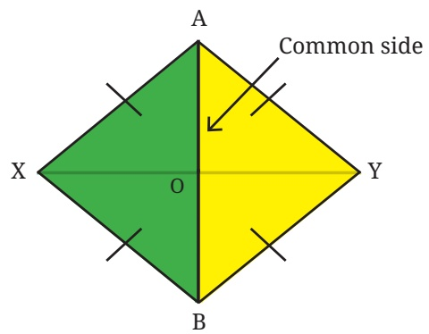

In ∆AOX and ΔAOY, we already know that AX = AY, and AO is common to both triangles.

If we can show that $\angle XAO = \angle YAO$ then, by the SAS congruence condition, we can conclude that the triangles are congruent.

To show this, we observe that $\Delta \mathrm{ABX} \cong \Delta \mathrm{ABY}.$ This is so because AX = AY, BX = BY, and AB is common to both the triangles.

Thus, we have $\angle \mathrm{XAB} = \angle \mathrm{YAB},$ or $\angle XAO = \angle YAO$ because they are corresponding parts of congruent triangles.

Hence, AB is the perpendicular bisector of XY.

We can have eyes of different shapes.

