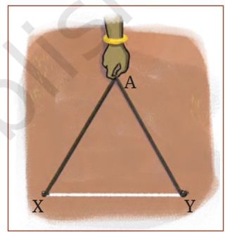
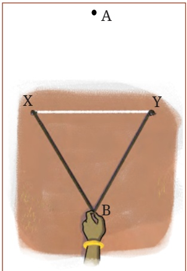

methods in the Śulba-Sūtras make use of a different kind of compass from what you would have used — a rope. A rope can be used to draw circles or arcs. It can also be stretched to form a straight line.

In addition, the Śulba-Sūtras also contain other methods to construct perpendicular lines. Here is an interesting construction of the perpendicular bisector using a rope (Kātyāyana-Śulbasūtra 1.2).

Let XY be the given line segment, drawn on the ground, for which we need to construct a perpendicular bisector. Fix a small pole or peg vertically into the ground at each point X and Y.

Take a sufficiently long rope. Make two loops at its ends. Without taking into account the parts of the rope that has gone into the loops, fold the rope into half to find and mark its midpoint.

Fasten the two loops at the ends of the rope to the poles at X and Y.

Pull the midpoint of the rope above XY, as shown in the figure, such that the two parts of the rope on either side are fully stretched. Mark this position of the midpoint as A.

Now similarly pull the midpoint of the rope below XY, as shown in the figure, such that the two parts of the rope on either side are fully stretched. Mark this position of the midpoint as B.

AB is the required perpendicular bisector.

Fig. 6.4

## Figure it Out

1. Justify why AB in Fig. 6.4 is the perpendicular bisector.

2. Can you think of different methods to construct a 90° angle at a given point on a line using a rope?

