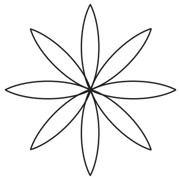
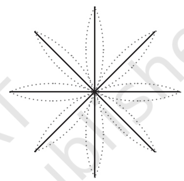
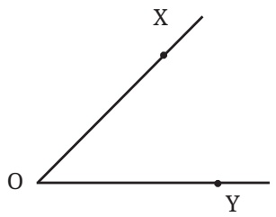
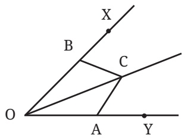

**Angle Bisection for a Design**

How do we construct this figure?

Fig. 6.5

The supporting lines for this figure will look like this.

What is the angle between two adjacent lines?

We need the angle between every pair of adjacent lines to be equal. Since $3 6 0 ^ { \circ }$ is equally divided into 8 parts, every angle is $4 5 ^ { \circ }$

? How do we construct a $4 5 ^ { \circ }$ angle using only a ruler and a compass? We know how to construct a $9 0 ^ { \circ }$ angle. If we can divide it into two equal parts, or bisect it, then we get a $4 5 ^ { \circ }$ angle.

We will now develop a general method to bisect any angle. Consider an angle ∠XOY.

We can bisect it if we can draw two congruent triangles ΔOBC and ΔOAC as shown in the figure. Then $\angle BOC = \angle AOC$

