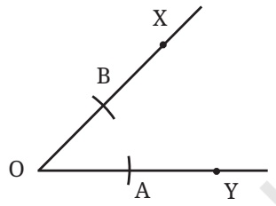
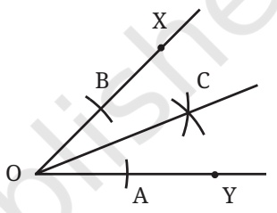
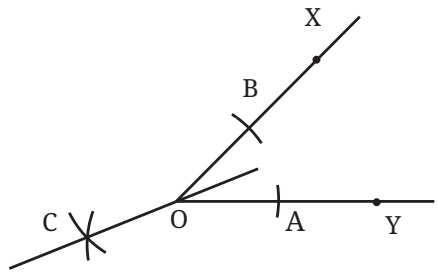

## How do we construct these congruent triangles, given the angle?

If A and B are marked such that $\mathrm { O A = O B } ,$ , and if C is chosen such that $\mathrm{BC} = \mathrm{AC}_{:}$ , then by the SSS congruence condition, $\Delta \mathrm { O B C } \cong \Delta \mathrm { O A C } .$ So we can bisect an angle as follows.

**Steps for Angle Bisection**

1. Mark points A and B such that $\mathrm { O A } = \mathrm { O B }$

2. Choosing any sufficiently long radius, cut arcs from A and B, keeping the radius same. Mark the point of intersection as C.

3. OC bisects $\angle  AOB.$

So, a $4 5 ^ { \circ }$ angle can be constructed by first constructing a $9 0 ^ { \circ }$ angle and then bisecting it.

## Figure it Out

1. Construct at least 4 different angles. Draw their bisectors.

2. Construct the 8-petalled figure shown in Fig. 6.5.

3. In Step 2 of angle bisection, if arcs of equal radius are drawn on the other side, as shown in the figure, will the line OC still be an angle bisector? Explore this through construction, and then justify your answer.

4. What are the other angles that can be constructed using angle bisection? Can you construct $6 5 . 5 ^ { \circ }$ angle?

5. Come up with a method to construct the angle bisector using a rope.